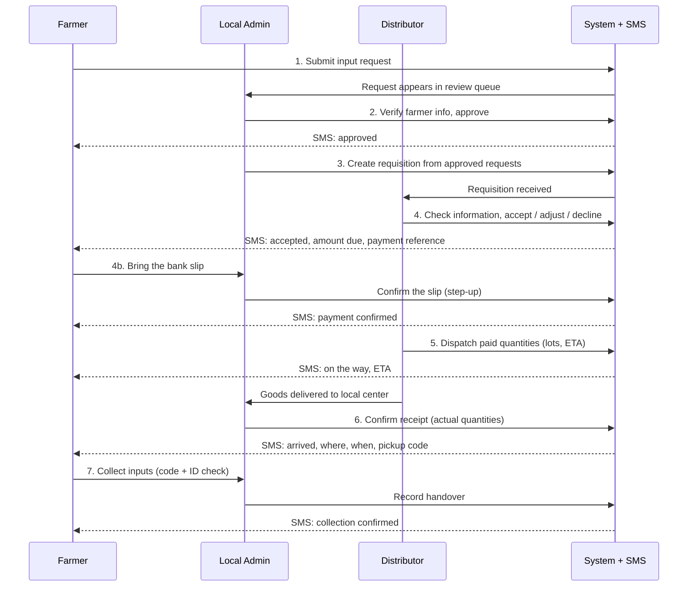
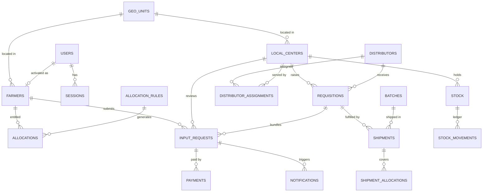

# AgroTrust: Complete Design Document

**Digitizing Agricultural Input Delivery in Ethiopia**

| | |
|---|---|
| **Version** | 3 (design complete for the pilot scope, nothing implemented yet) |
| **Stack** | React PWA · NestJS · MongoDB · JWT authentication · SMS gateway · Bank-slip payment recorded by the local admin |
| **Scope** | Pilot in one woreda (about 20,000 farmers), designed to scale to a region and then the country |

This single document combines the project overview, the backend and database design, the authentication design and the design decisions. Cross-references such as `§2.9.6` mean *Part 2, section 9.6*.

### What changed in v3
1. Authentication is now **our own JWT system** (PIN/password, MFA, revocable sessions). Fayda is no longer used for login. Identity is verified **in person** by the local admin against the government registry.
2. All open questions from the earlier draft are **answered** in Part 4.
3. A **payment** step was added: after the distributor accepts and before dispatch, the farmer pays the supplier by bank. The local admin records the bank slip. The admin never takes the cash.
4. Requisition processing is **chunked**, and one requisition can have **several shipments**.
5. Distributors are **assigned by rule**, and entitlements come from **versioned allocation rules**.

### How to read this document
| Part | Read it for |
|---|---|
| **Part 1: Project Overview** | The problem, the solution, the flow in plain language, expected outcomes |
| **Part 2: Backend & Database Design** | Actors, the 9-step flow and state machine, architecture, modules, MongoDB schema, transactions, SMS, REST API, security, jobs, testing, build order |
| **Part 3: Authentication & Authorization** | Credentials, JWT and refresh tokens, sessions, MFA, invitations, step-up, RBAC matrix, NestJS structure, auth API, threat model |
| **Part 4: Design Decisions, Operations & Rollout** | Answers to the 12 open questions, payment model, chunking, scale targets, frontend plan, deployment and DR, rollout phases |

---

## Contents

- [**Part 1: Project Overview**](#part-1-project-overview)
  - [1.1 Problem Statement](#11-problem-statement)
  - [1.2 Solution](#12-solution)
  - [1.3 How It Works](#13-how-it-works)
  - [1.4 Expected Outcomes](#14-expected-outcomes)
  - [1.5 Authentication and Security](#15-authentication-and-security)
  - [1.6 Tech Stack](#16-tech-stack)
- [**Part 2: Backend & Database Design**](#part-2-backend--database-design)
  - [2.1 Goals and Design Principles](#21-goals-and-design-principles)
  - [2.2 Actors and the Core Flow](#22-actors-and-the-core-flow)
  - [2.3 Key Design Decision: Identity vs. Eligibility](#23-key-design-decision-identity-vs-eligibility)
  - [2.4 High-Level Architecture](#24-high-level-architecture)
  - [2.5 Backend Modules](#25-backend-modules)
  - [2.6 Roles and Access Control (RBAC)](#26-roles-and-access-control-rbac)
  - [2.7 Authentication (summary)](#27-authentication-summary)
  - [2.8 Database Design (MongoDB)](#28-database-design-mongodb)
  - [2.9 Core Transaction Designs](#29-core-transaction-designs)
  - [2.10 Notifications (SMS)](#210-notifications-sms)
  - [2.11 REST API (v1, `/api/v1`)](#211-rest-api-v1-apiv1)
  - [2.12 Security](#212-security)
  - [2.13 Background Jobs](#213-background-jobs)
  - [2.14 Cross-Cutting Concerns](#214-cross-cutting-concerns)
  - [2.15 Testing Strategy](#215-testing-strategy)
  - [2.16 Resolved Questions](#216-resolved-questions)
  - [2.17 Suggested Build Order](#217-suggested-build-order)
- [**Part 3: Authentication & Authorization**](#part-3-authentication--authorization)
  - [3.1 Principles](#31-principles)
  - [3.2 Identities and Credentials](#32-identities-and-credentials)
  - [3.3 Token Design](#33-token-design)
  - [3.4 Data Model (MongoDB)](#34-data-model-mongodb)
  - [3.5 Flows](#35-flows)
  - [3.6 Brute-Force and Abuse Protection](#36-brute-force-and-abuse-protection)
  - [3.7 Authorization (RBAC + scope)](#37-authorization-rbac--scope)
  - [3.8 NestJS Implementation Structure](#38-nestjs-implementation-structure)
  - [3.9 API Endpoints (`/api/v1/auth`)](#39-api-endpoints-apiv1auth)
  - [3.10 Threat Model (summary)](#310-threat-model-summary)
  - [3.11 Testing](#311-testing)
  - [3.12 Operational Notes](#312-operational-notes)
  - [3.13 Optional Later: Fayda as an Identity Check](#313-optional-later-fayda-as-an-identity-check)
- [**Part 4: Design Decisions, Operations & Rollout**](#part-4-design-decisions-operations--rollout)
  - [4.A Answers to the open questions](#4a-answers-to-the-open-questions)
  - [4.B Gaps found in the review and how they are closed](#4b-gaps-found-in-the-review-and-how-they-are-closed)
  - [4.C Decision summary](#4c-decision-summary)

---

## Part 1: Project Overview

**Digitizing Agricultural Input Delivery in Ethiopia**

AgroTrust is a digital platform that gives smallholder farmers **verified, direct access** to agricultural inputs such as fertilizer. Farmers are verified **in person by a government local admin**, sign in with their own secure account, and every step from supplier to farmer is tracked.

---

### 1.1 Problem Statement

In Ethiopia, brokers exploit the agricultural input supply system by stockpiling or reselling inputs like fertilizers at inflated prices. The lack of a digital distribution system results in:

- Unfair access for smallholder farmers
- Inflated input costs
- Loss of trust and transparency

### 1.2 Solution

AgroTrust enables **verified, direct access** to agricultural inputs. It provides:

- ✅ Government-verified farmer accounts (in-person verification, secure PIN login)
- ✅ Per-farmer entitlements, so nobody can take more than their share
- ✅ Payment straight to the supplier, with no cash handled by officials
- ✅ End-to-end traceability from supply lot to farmer handover
- ✅ Transparent, tamper-evident audit logging
- ✅ SMS updates to every farmer at every key step
- ✅ Admin dashboards for analytics, shortages and fraud monitoring

---

### 1.3 How It Works

1. **Verify:** the farmer is in the government registry and verified **in person by the local admin**, who gives them an activation code to create their account.
2. **Request:** the farmer requests the inputs they need, in the app or through the local admin (confirmed by an SMS code).
3. **Approve:** the local admin checks the request against the farmer's information and entitlement.
4. **Requisition:** the local admin sends the approved requests to the **assigned distributor** (government or private).
5. **Distributor check:** the distributor verifies the information and accepts, adjusts or declines.
6. **Pay:** the farmer pays the supplier by bank, then brings the slip to the local admin, who checks it and records the payment.
7. **Dispatch:** the distributor sends the paid inputs to the local center.
8. **Receive:** the local admin confirms what arrived and the farmer is told where and when to collect.
9. **Hand over:** the farmer collects the inputs using a one-time code.

📱 **The farmer receives an SMS at every key step**: approved, accepted (with amount to pay), payment confirmed, on the way (with expected arrival), arrived (where, when and the pickup code), and collected.

---

### 1.4 Expected Outcomes

#### For Farmers
- Transparent pricing and access
- Direct purchase without brokers
- A trustworthy government system, with updates in Amharic, Afaan Oromo or English

#### For Government
- End-to-end traceability of inputs
- Elimination of black-market interference
- Real-time insight into shortages and distribution

---

### 1.5 Authentication and Security

- **Farmers:** phone number + 6-digit PIN, SMS code on a new device.
- **Staff:** password + mandatory authenticator-app code (TOTP).
- **JWT access tokens** (10-15 minutes) with **rotating refresh tokens**, revocable sessions, and step-up re-authentication for sensitive actions.
- Staff accounts are created only by **invitation** from a higher admin, with two-person approval for admin roles.
- Role- and scope-based access control, enforced in guards and in the data layer.
- Hash-chained audit log, strict rate limiting, and data minimization (distributors never see phone numbers).

Details: Part 3.

---

### 1.6 Tech Stack

| Component | Technology |
|---|---|
| Frontend | React PWA (English, Amharic, Afaan Oromo) |
| Backend | NestJS (modular monolith) |
| Database | MongoDB (replica set, transactions) |
| Authentication | JWT (EdDSA) + refresh rotation, Argon2id, TOTP |
| Notifications | SMS gateway (Ethio Telecom or licensed aggregator) |
| Payments | Bank slip recorded by the local admin |
| Ops | Docker, CI/CD, Prometheus, in-country hosting |

---

## Part 2: Backend & Database Design

### 2.1 Goals and Design Principles

| Principle | What it means for the design |
|---|---|
| **Identity-bound transactions** | Every request is tied to an authenticated account and a verified farmer registry record. Verification is done in person by a government local admin. |
| **No over-allocation, no overselling** | Farmer quotas and center stock are enforced atomically in the database, never by read-then-write in application code. |
| **Traceability** | Every kilogram is followed from supply batch → shipment → local center → farmer handover. |
| **Human checkpoints are audited** | The local admin is a trusted human step, so every approval, receipt and handover is logged, reconciled and visible to the farmer by SMS. |
| **No cash in the chain** | Payment goes directly to the distributor or government account by mobile money or bank. Local admins never handle money. |
| **Farmers are always informed** | Every important status change triggers an SMS to the farmer. |
| **Data minimization** | Never store raw national ID numbers or biometrics (only a keyed hash for duplicate detection). Distributors see only what they need. |
| **Modular monolith** | One deployable NestJS app with strict module boundaries. It can be split later if needed. |

---

### 2.2 Actors and the Core Flow

#### 2.2.1 Actors

| Actor | Who they are | Role in the system |
|---|---|---|
| **Farmer** | Registered smallholder farmer | Requests inputs, pays, receives SMS updates, collects inputs |
| **Local Admin** | Government representative at kebele/woreda level | Verifies farmer information, approves requests, bundles them into a requisition, receives goods from the distributor, hands them to farmers |
| **Distributor** | Government supplier **or** licensed private supplier | Checks the requisition, accepts / adjusts / declines it, dispatches paid goods to the local center |
| **Regional / National Admin** | Oversight | Seasons, prices, allocation rules, distributor assignment, registry, analytics, audit |
| **Auditor** | Read-only oversight | Audit logs, analytics, fraud flags |
| **System** | AgroTrust | Holds farmer data, enforces quotas, tracks stock, logs everything, sends SMS |

#### 2.2.2 The flow, step by step

| # | Step | Who | System effect | SMS to farmer |
|---|---|---|---|---|
| 0 | **Registration and activation:** farmer is in the registry, verified in person by the local admin, and activates an account with an activation code and a PIN | Local Admin (+ registry import) | Farmer `verified`, account `active` | Account verified |
| 1 | **Request:** farmer says which inputs and how much they need, in the app **or** through the local admin (farmer confirms by SMS OTP bound to the request contents) | Farmer / Local Admin | Request `SUBMITTED`. Quota reserved atomically | Request received |
| 2 | **Review:** local admin checks the farmer's information and the request against their allocation, then approves or rejects | Local Admin | `APPROVED` or `REJECTED` (reason required) | Approved / Rejected + reason |
| 3 | **Requisition:** local admin bundles approved requests into one consolidated order to the **assigned distributor** | Local Admin | Requests → `REQUISITIONED`. Requisition `SUBMITTED` | None |
| 4 | **Distributor check:** distributor verifies the requisition and accepts, partially accepts or declines | Distributor | Requests → `ACCEPTED` (payment due) or `WAITLISTED`/`DECLINED`. Quota released for declined | Accepted + amount, payment reference and deadline / Declined + reason |
| 4b | **Payment:** farmer pays the supplier by bank and brings the slip to the local admin | Farmer + Local Admin | Admin confirms the slip → request `PAID` | Payment confirmed |
| 5 | **Dispatch:** distributor ships **paid** quantities to the local center, recording lots, quantities and ETA | Distributor | Shipment `IN_TRANSIT`. Covered requests → `IN_TRANSIT` | **"On the way", with ETA** |
| 6 | **Receipt:** local admin confirms what actually arrived | Local Admin | Stock at the center increases. Covered requests → `READY_FOR_PICKUP`. Pickup code issued. Differences logged as a discrepancy | **"Arrived at [center], collect by [date], code [XXXXXXXX]"** |
| 7 | **Handover:** farmer collects. Local admin verifies the code and identity, then hands over | Farmer / Local Admin | Request `COMPLETED`. Stock and quota counters updated | Collection confirmed |



#### 2.2.3 Request state machine

```
SUBMITTED ─► APPROVED ─► REQUISITIONED ─► ACCEPTED ─► PAID ─► IN_TRANSIT ─► READY_FOR_PICKUP ─► COMPLETED
    │           │              │              │         │          │                │
    ▼           ▼              ▼              ▼         ▼          ▼                ▼
 REJECTED   CANCELLED   DECLINED / WAITLISTED  EXPIRED  REFUNDED  (held on       EXPIRED
                                             (UNPAID)  (if short) discrepancy)  (UNCOLLECTED)
```

- `ACCEPTED`: approved by the distributor, **payment due** by `paymentDueAt` (default 7 days).
- `WAITLISTED`: a tag on approved/requisitioned requests not yet covered by supply. They are served from later shipments until the requisition cutoff.
- `CANCELLED`: farmer or admin cancels before payment. After payment, cancellation goes through a refund flow.
- `DECLINED`: distributor will not supply it (ineligible, no supply by cutoff).
- `EXPIRED`: either `UNPAID` (payment deadline passed, quota released) or `UNCOLLECTED` (pickup deadline passed, earmark released).
- `REFUNDED`: paid but could not be supplied (shortage), refunded or kept as credit.
- Every transition writes a `statusHistory` entry, an audit log entry and (where listed in §2.10) a queued SMS.

#### 2.2.4 Why the local admin needs controls

The local admin is a powerful human checkpoint. Without controls they would become the new "broker". The design counters this with:

- **Farmer-held proof:** goods are handed over only against the farmer's one-time pickup code (sent by SMS) and identity check.
- **Assisted requests need the farmer's consent:** the farmer confirms with an SMS OTP bound to the exact items and quantities.
- **No cash handling:** the farmer pays the supplier's bank account. The local admin only checks the slip and records it. The admin never receives the money.
- **Reconciliation:** dispatched vs. received vs. handed-over quantities (and payments vs. goods) are compared. Any gap raises a flag.
- **Visibility:** the farmer sees every step by SMS. Distributor and admins see every step in dashboards.
- **Separation of duties:** two staff per center, with a flag when one person receives and hands over the same shipment.
- **Complete audit trail:** approvals, overrides, adjustments and handovers are hash-chained (§2.8.3 `audit_logs`).

---

### 2.3 Key Design Decision: Identity vs. Eligibility

An account proves **who is logging in**. It does **not** prove that the person is **an eligible farmer** or how much they may receive. AgroTrust therefore holds its own **farmer registry** and **allocation (entitlement)** records, supplied by the government.

**Registry linking (decided):** the **local admin verifies the farmer in person** against an ID document and land record, then issues a one-time **activation code**. The farmer activates an account with that code (and an SMS OTP to the registered phone) and sets a PIN. See §3.5.1.

**Duplicate prevention:** an optional keyed hash of the ID number (`farmers.idRefHash`, unique sparse) prevents one person being registered twice, without storing the number. Fayda can later be added as an optional extra check (§3.13).

---

### 2.4 High-Level Architecture

```
 React PWA ──HTTPS──► NestJS API (REST, /api/v1) ──► MongoDB (3-node replica set)
 (Farmer / Local Admin /     │   ▲                      │
  Distributor / Admin)       │   └── Worker: scheduled jobs, SMS outbox, chunked processing
                             └──► SMS gateway (send, delivery reports)
```

**Runtime requirements**
- MongoDB **must run as a replica set** (single-node replica set locally) because critical steps use **multi-document transactions**.
- **No Redis in v1.** Short-lived auth state uses MongoDB TTL indexes. Scheduled jobs use `@nestjs/schedule` with a DB-backed lock. The SMS outbox and chunk processing run in a separate **worker process** (same codebase). BullMQ + Redis is added in Phase 2 if SMS volume requires it.
- Stateless API instances (3+) behind a load balancer. Capacity targets are in §4.B.5.

---

### 2.5 Backend Modules

| Module | Responsibility |
|---|---|
| `auth` | Login (PIN/password), JWT, refresh rotation, MFA, step-up, sessions, invitations, activation (Part 3) |
| `users` | Accounts, roles, scope, roleVersion |
| `farmers` | Registry, in-person verification, activation codes, contact details |
| `geo` | Region → zone → woreda → kebele hierarchy |
| `seasons` | Agricultural seasons, request/requisition windows, priority policy |
| `catalog` | Input types and official price history, subsidies |
| `allocations` | Allocation rules, per-farmer entitlements and quota counters |
| `local-centers` | Physical depots run by local admins (where goods arrive and are collected) |
| `distributors` | Distributor organizations, staff, and per-season center assignments |
| `requests` | Farmer input requests and their review |
| `requisitions` | Consolidated orders from a local center to a distributor, chunked processing |
| `payments` | Bank-slip confirmation by the local admin, then refunds |
| `shipments` | Dispatch, transport, receipt and discrepancies (multiple per requisition) |
| `inventory` | Batches, stock per center, append-only stock ledger |
| `pickups` | Pickup-code verification and handover |
| `notifications` | SMS outbox, templates, gateway, delivery reports |
| `audit` | Append-only, hash-chained audit trail |
| `analytics` | Dashboards, shortage detection, fraud flags |
| `common` | Guards, interceptors, filters, pipes, config, logging |

Rules: modules talk only through exported services. A module never reads another module's collection directly. Business logic lives in services, not controllers.

---

### 2.6 Roles and Access Control (RBAC)

| Role | Scope | Can do |
|---|---|---|
| `farmer` | Self | View allocations and catalog, submit and cancel requests, pay, view own history and notifications |
| `local_admin` | Assigned local center(s) (max 3) | Verify farmers, issue activation codes, enter assisted requests, approve/reject requests, create requisitions, receive shipments, verify pickups and hand over, view center stock |
| `distributor_staff` | Own distributor organization | View requisitions addressed to them, accept/adjust/decline, create batches and shipments |
| `regional_admin` | Own region | Allocation rule proposals, center and distributor setup and assignment, invite local admins and distributor staff, regional analytics, discrepancy resolution, override approval |
| `national_admin` | All | Seasons, catalog, prices, allocation rules, registry import, invite regional admins, all analytics |
| `auditor` | All, read-only | Audit logs, analytics, fraud flags |

Authorization combines **role + scope**, enforced by guards **and** in the repository layer (deny by default). The full permission matrix, guard pipeline and step-up rules are in §3.7.

---

### 2.7 Authentication (summary)

Full design: **Part 3**.

| Topic | Decision |
|---|---|
| Farmer login | Phone + 6-digit PIN. SMS OTP on a new device and for PIN reset. |
| Staff login | Email/phone + password (12-14+ chars) + **mandatory TOTP** (SMS OTP fallback for local admins only). |
| Access token | JWT signed with **EdDSA**, 10-15 min, claims `sub, sid, rv, role` (no PII). |
| Refresh token | Opaque, hashed at rest, **rotated on every use** with reuse detection. Web: httpOnly `__Host-` cookie. Mobile: secure storage. |
| Revocation | `roleVersion` check makes suspension, role changes and force-logout effective within about a minute. |
| Step-up | Fresh credential proof (5 min) for requisitions, receipts, overrides, price/role changes. |
| Onboarding | Farmers: in-person verification + activation code. Staff: **invitation** by a higher admin (dual control for admin roles). First admin by one-time CLI seed. |
| Hashing | Argon2id with a server-side pepper. |
| Abuse control | Per-account and per-IP lockout, OTP limits, uniform errors and timing. |

---

### 2.8 Database Design (MongoDB)

#### 2.8.1 Conventions
- **Money:** integer **santim**. Never floats.
- **Quantities:** integer **kilograms** (base unit). Quintals only in the UI.
- **Timestamps:** UTC `Date`; `createdAt` / `updatedAt` on every collection.
- **IDs:** `ObjectId`. Human-facing numbers (`requestNo`, `requisitionNo`, `shipmentNo`, `paymentNo`) are separate unique fields.
- **Embed vs. reference:** embed small, bounded, always-read-together data (line items). Reference everything else.
- **Soft delete:** use `status`. Never hard-delete regulated records.
- **Validation:** Mongoose schemas **plus** `$jsonSchema` validators on critical collections.

#### 2.8.2 Entity relationships



#### 2.8.3 Collections

##### Authentication collections
`users`, `credentials`, `sessions`, `refresh_tokens`, `trusted_devices`, `otp_challenges`, `login_attempts`, `invitations`, `farmer_activations` and `security_events` are specified in **§3.4** (the `users` collection no longer has any Fayda fields). In summary, `users` holds `{ phone, email?, fullName, roles[], scope, roleVersion, status, preferredLanguage, mfa, lastLoginAt }` with unique `{ phone }` and unique sparse `{ email }`.

##### `farmers`: government farmer registry
| Field | Type | Notes |
|---|---|---|
| `registryId` | string | Official registry identifier (unique) |
| `userId` | ObjectId? | Set when the farmer activates an account |
| `fullName` | string | As registered |
| `geo` | `{ regionId, zoneId, woredaId, kebeleId }` | |
| `localCenterId` | ObjectId | Center that serves this farmer |
| `landHoldingHa` | number | Basis for allocation |
| `crops` | string[] | Optional basis for allocation |
| `contact` | `{ phone, phoneVerified, smsEnabled, sharedPhone }` | SMS target. Field-level encryption recommended. Shared phones limited to 5 farmers |
| `idRefHash` | string? | `HMAC(pepper, normalizedIdNumber)`, unique sparse. Duplicate detection only |
| `status` | enum | `unlinked` · `pending_verification` · `verified` · `suspended` |
| `verifiedBy`, `verifiedAt` | ObjectId, Date | Local admin who confirmed identity in person |

**Indexes:** unique `{ registryId: 1 }`; unique sparse `{ userId: 1 }`; unique sparse `{ idRefHash: 1 }`; `{ localCenterId: 1, status: 1 }`; `{ "geo.kebeleId": 1 }`; `{ "contact.phone": 1 }`.

##### `geo_units`
`{ type: region|zone|woreda|kebele, code, name: { en, am, om }, parentId, path[] }`
**Indexes:** unique `{ code: 1 }`; `{ parentId: 1 }`; `{ path: 1 }`.

##### `seasons`
`{ code: "2026-MEHER", name, startsAt, endsAt, requestsOpenAt, requestsCloseAt, requisitionCutoffAt, paymentWindowDays, pickupWindowDays, priorityPolicy: FCFS|SMALLEST_LAND_FIRST, status: draft|open|closed }`
**Indexes:** unique `{ code: 1 }`.

##### `inputs`
`{ code: "UREA", name: { en, am, om }, category: fertilizer|seed|agrochemical, baseUnit: "kg", packSizeKg, active }`
**Indexes:** unique `{ code: 1 }`.

##### `prices`: official price history (never overwritten)
`{ inputId, seasonId, regionId?, unitPriceSantimPerKg, subsidySantimPerKg, effectiveFrom, effectiveTo?, setBy, approvedBy, reason }`
**Indexes:** `{ inputId: 1, seasonId: 1, regionId: 1, effectiveFrom: -1 }`.
The price and subsidy are **copied into the request** at submission so later changes never alter past requests. Changes need step-up and a second approver.

##### `local_centers`: physical depots
`{ code, name, geo: {…}, location: GeoJSON Point, address, openingHours, localAdminUserIds[], servesKebeleIds[], capacityKg?, status }`
**Indexes:** unique `{ code: 1 }`; `2dsphere` on `location`.

##### `distributors`
`{ code, name, type: government|private, licenceNo, contact: { phone, email }, serviceRegionIds[], bankAccountRef?, status: active|suspended }`
**Indexes:** unique `{ code: 1 }`; `{ serviceRegionIds: 1 }`.

##### `distributor_assignments`
`{ seasonId, localCenterId, inputCategory, distributorId, priority, setBy, approvedBy? }`
**Indexes:** unique `{ seasonId: 1, localCenterId: 1, inputCategory: 1, distributorId: 1 }`.
Requisitions can only be created for the assigned distributor. Changes need regional admin approval.

##### `allocation_rules`
`{ seasonId, inputId, regionId?, rateKgPerHa, minKg, maxHa, maxKgPerFarmer, cropFilter?, version, effectiveFrom, createdBy, approvedBy }`
**Indexes:** unique `{ seasonId: 1, inputId: 1, regionId: 1, version: 1 }`.
Formula: `entitledKg = clamp(min(landHoldingHa, maxHa) × rateKgPerHa, minKg, maxKgPerFarmer)`.

##### `allocations`: per-farmer entitlements and quota counters
| Field | Notes |
|---|---|
| `farmerId`, `seasonId`, `inputId` | Unique together |
| `entitledKg` | Maximum this farmer may receive |
| `reservedKg` | In requests that are not yet completed |
| `purchasedKg` | Completed handovers |
| `basis` | `{ landHoldingHa, rateKgPerHa, ruleVersion }` for explainability |

**Indexes:** unique `{ farmerId: 1, seasonId: 1, inputId: 1 }`.
**Invariant:** `reservedKg + purchasedKg ≤ entitledKg`.
Manual corrections are audited `allocation_adjustments` entries (reason required).

##### `input_requests`: the farmer's request
| Field | Type | Notes |
|---|---|---|
| `requestNo` | string | Unique, human-friendly (e.g. `RQ-26-000123`) |
| `farmerId`, `seasonId`, `localCenterId` | ObjectId | |
| `items[]` | `{ inputId, qtyKg, acceptedQtyKg?, unitPriceSantimPerKg, subsidySantimPerKg, lineTotalSantim }` | Embedded, bounded |
| `totalSantim`, `payableSantim` | number | Payable = total − subsidy |
| `status` | enum | See §2.2.3 |
| `waitlisted` | boolean | Not yet covered by supply |
| `statusHistory[]` | `{ status, at, actorId?, reason? }` | |
| `channel` | enum | `self` · `assisted` |
| `submittedBy` | `{ userId, role }` | Farmer or local admin |
| `consent` | `{ method: "app" \| "sms_otp", otpChallengeId, confirmedAt }` | Required for assisted requests |
| `reviewedBy`, `reviewedAt`, `rejectionReason` | | Local admin review |
| `requisitionId` | ObjectId? | Set at step 3 |
| `paymentDueAt`, `paidAt` | Date? | |
| `pickupCodeHash`, `pickupAttempts`, `pickupExpiresAt` | | Code stored only as an HMAC |
| `idempotencyKey` | string | Prevents double submission |

**Indexes:** unique `{ requestNo: 1 }`; unique `{ farmerId: 1, idempotencyKey: 1 }`; `{ farmerId: 1, createdAt: -1 }`; `{ localCenterId: 1, status: 1, createdAt: 1 }`; `{ requisitionId: 1, status: 1 }`; `{ status: 1, paymentDueAt: 1 }`; `{ status: 1, pickupExpiresAt: 1 }`.

##### `requisitions`: consolidated order from a local center to a distributor
| Field | Notes |
|---|---|
| `requisitionNo` | Unique |
| `localCenterId`, `distributorId`, `seasonId` | |
| `lines[]` | `{ inputId, requestedKg, acceptedKg, paidKg, shippedKg, receivedKg }` (aggregated; shipped/received are sums over all shipments) |
| `requestCount` | Number of farmer requests bundled |
| `status` | `DRAFT` · `SUBMITTED` · `ACCEPTED` · `PARTIALLY_ACCEPTED` · `DECLINED` · `FULFILLED` · `CANCELLED` |
| `processing` | `{ step, cursor, processed, total, status: running\|paused\|done\|failed, startedAt }` for chunked steps (§2.9.3) |
| `submittedBy`, `respondedBy`, `respondedAt`, `responseReason` | |
| `statusHistory[]` | |

**Indexes:** unique `{ requisitionNo: 1 }`; `{ distributorId: 1, status: 1, createdAt: -1 }`; `{ localCenterId: 1, status: 1 }`; `{ "processing.status": 1 }`.
Individual requests point to their requisition through `input_requests.requisitionId`, so the requisition document stays small.

##### `payments`
`{ paymentNo, requestId, farmerId, amountSantim, provider: bank, providerRef, status: confirmed|refunded|credit, idempotencyKey, initiatedAt, confirmedAt }`
`providerRef` is the bank slip number the local admin typed. `paymentNo` is derived from the request number (`RQ-26-000123` → `PY-26-000123`).
**Indexes:** unique `{ paymentNo: 1 }`; unique `{ provider: 1, providerRef: 1 }`; unique `{ idempotencyKey: 1 }`; `{ requestId: 1 }`; `{ status: 1, initiatedAt: 1 }`.
The same slip number cannot confirm two requests. A repeated `Idempotency-Key` returns the original payment.

##### `batches`: supply lots (traceability origin)
`{ lotNumber, distributorId, inputId, seasonId, quantityKg, source, importRef?, documents[], createdBy }`
**Indexes:** unique `{ lotNumber: 1 }`.

##### `shipments`
| Field | Notes |
|---|---|
| `shipmentNo` | Unique |
| `requisitionId`, `distributorId`, `localCenterId` | Many shipments per requisition |
| `lines[]` | `{ inputId, batchId, qtyKg }` dispatched |
| `dispatchedAt`, `etaAt` | |
| `transport` | `{ vehiclePlate, driverName, driverPhone }` |
| `status` | `IN_TRANSIT` · `RECEIVED` · `RECEIVED_WITH_DISCREPANCY` · `CANCELLED` |
| `receivedBy`, `receivedAt`, `receivedLines[]` | Actual quantities confirmed by the local admin |
| `discrepancy` | `{ note, resolvedBy?, resolution? }` |
| `processing` | Chunk cursor for earmarking |

**Indexes:** unique `{ shipmentNo: 1 }`; `{ requisitionId: 1 }`; `{ localCenterId: 1, status: 1 }`; `{ distributorId: 1, status: 1 }`; `{ status: 1, etaAt: 1 }`.

##### `shipment_allocations`: which requests a shipment covers
`{ shipmentId, requestId, inputId, qtyKg }`; unique `{ shipmentId: 1, requestId: 1, inputId: 1 }`; `{ requestId: 1 }`.
Used instead of embedding request lists, so large shipments stay within document limits.

##### `stock`: current stock per local center
`{ localCenterId, inputId, seasonId, onHandKg, reservedKg }`
`reservedKg` = earmarked for farmers whose requests are `READY_FOR_PICKUP`. Available = `onHandKg − reservedKg` (derived).
**Indexes:** unique `{ localCenterId: 1, inputId: 1, seasonId: 1 }`.
**Invariant:** `0 ≤ reservedKg ≤ onHandKg`.

##### `stock_movements`: append-only ledger
`{ type: receipt|reservation|release|issue|return_to_distributor|adjustment, localCenterId, inputId, seasonId, qtyKg, batchId?, shipmentId?, requestId?, actorId, note, at }`
**Indexes:** `{ localCenterId: 1, inputId: 1, seasonId: 1, at: -1 }`; `{ requestId: 1 }`; `{ shipmentId: 1 }`; `{ batchId: 1 }`.
Rows are only **inserted**. Corrections are new `adjustment` rows. A nightly job recomputes stock from the ledger and flags drift.

##### `notifications`: SMS outbox and history
| Field | Notes |
|---|---|
| `recipient` | `{ farmerId?, userId?, phone }` |
| `event` | e.g. `REQUEST_APPROVED`, `PAYMENT_REQUIRED`, `GOODS_ARRIVED` |
| `language` | `en` · `am` · `om` |
| `params` | Template values (request number, center name, date, ETA, code, amount) |
| `body` | Rendered text at send time (codes and OTPs are redacted after delivery) |
| `status` | `queued` · `sent` · `delivered` · `failed` · `manual` |
| `attempts`, `nextAttemptAt`, `providerMessageId`, `failureReason` | |
| `related` | `{ type, id }` |

**Indexes:** `{ status: 1, nextAttemptAt: 1 }`; unique `{ related.type, related.id, event }`; `{ "recipient.farmerId": 1, createdAt: -1 }`; `{ providerMessageId: 1 }`.

##### `audit_logs`: append-only, hash-chained
| Field | Notes |
|---|---|
| `seq` | Monotonic sequence number |
| `at`, `actor { userId, role, ip, userAgent }` | |
| `action` | `REQUEST_APPROVED`, `REQUISITION_SUBMITTED`, `PAYMENT_CONFIRMED`, `SHIPMENT_RECEIVED`, `PICKUP_COMPLETED`, `PRICE_CHANGED`, `STOCK_ADJUSTED`, `ROLE_CHANGED`, … |
| `entity { type, id }`, `changes` | Minimal before/after diff (no unnecessary PII) |
| `requestId` | Correlates with application logs |
| `prevHash`, `hash` | `hash = SHA-256(prevHash ‖ canonical(record))` |

**Indexes:** unique `{ seq: 1 }`; `{ "entity.type": 1, "entity.id": 1, at: -1 }`; `{ "actor.userId": 1, at: -1 }`.
**Protection:** the app's DB user has insert and read only on this collection. A scheduled job verifies the chain and publishes the latest hash externally (e.g. a signed daily digest).

##### `fraud_flags`
`{ type, severity, farmerId?, requestId?, localCenterId?, distributorId?, shipmentId?, paymentId?, details, status: open|reviewing|resolved, resolvedBy }`; `{ status: 1, severity: 1, createdAt: -1 }`.

##### `daily_snapshots`: precomputed analytics
`{ date, level: national|region|woreda|center|distributor, geoId, inputId, seasonId, requestedKg, acceptedKg, paidKg, dispatchedKg, receivedKg, handedOverKg, onHandKg, requestCount, avgCycleDays }`; unique `{ date, level, geoId, inputId, seasonId }`.

---

### 2.9 Core Transaction Designs

Each step uses **MongoDB transactions** with retry on `TransientTransactionError`. Each transaction writes the audit entry and queues the SMS (outbox) **in the same transaction**, so a state change and its notification cannot get out of sync. Steps that touch many requests are **chunked** (§2.9.3).

#### 2.9.1 Submit request (step 1)
1. Validate: season is open for requests, farmer is `verified` with an active account (or an assisted request with a **confirmed OTP whose `payloadHash` matches the items**), the center serves the farmer. Return the original request if the `Idempotency-Key` was already used.
2. For each item, **conditionally reserve quota**:
   `updateOne({ farmerId, seasonId, inputId, $expr: { $lte: [ { $add: ["$reservedKg","$purchasedKg", qty] }, "$entitledKg" ] } }, { $inc: { reservedKg: qty } })`
   No match → reject with `QUOTA_EXCEEDED`.
3. Snapshot the current official price and subsidy into the request. Insert the request, audit entry and SMS.

#### 2.9.2 Review (step 2)
`SUBMITTED → APPROVED` or `REJECTED`. Rejection releases the reserved quota and requires a reason. The reviewer must be a local admin of the farmer's center.

#### 2.9.3 Create requisition (step 3) and chunked processing
1. Resolve the **assigned distributor** for the center, season and input category (`distributor_assignments`). Reject if none.
2. Select the center's `APPROVED` requests for the season, aggregate quantities per input into `lines[]`, and create the requisition `SUBMITTED` (step-up required).
3. Marking requests `REQUISITIONED` is done in **chunks of 300** (configurable). `requisitions.processing = { step, cursor, processed, total, status }` records progress. A worker resumes from `cursor` after a crash. Every chunk is idempotent (conditional updates on current status).
4. A final reconciliation recomputes totals from the processed requests and compares.

#### 2.9.4 Distributor response (step 4)
- **Accept all / partial / decline** at line level with `acceptedKg`.
- Acceptance is applied by the season's **priority policy** (default first-come-first-served by approval time) in chunks. Covered requests → `ACCEPTED` (with `acceptedQtyKg`, `paymentDueAt`). Uncovered requests are **`WAITLISTED`** until the requisition cutoff, then `DECLINED` with quota **released**.
- Farmers get an SMS with the final quantity, amount, payment reference and deadline, or the reason.

#### 2.9.4b Payment (step 4b)
1. The farmer pays the supplier's bank account using the payment reference, then brings the bank slip to the local admin of that center.
2. The local admin confirms the slip (`POST /local-admin/input-requests/:id/confirm-payment`, step-up, `Idempotency-Key`). The amount is the accepted quantity times the snapshotted price minus subsidy, in santim. In one transaction the service writes the `payments` row `confirmed`, sets the request `PAID` and `paidAt`, adds the accepted kilograms to `requisitions.lines[].paidKg`, writes the audit entry and queues the SMS.
3. Only an `ACCEPTED` request whose `paymentDueAt` is still in the future can be confirmed. A repeated key or the same slip on the same request returns the original payment.
4. Unpaid at `paymentDueAt` → request `EXPIRED` (`UNPAID`), the still-reserved kilograms are released, and the farmer gets an SMS. A slip for an expired request is rejected.
5. If a paid request cannot later be supplied (shortage), it becomes `REFUNDED` (refund or credit, farmer's choice).

#### 2.9.5 Dispatch (step 5)
Distributor creates a `shipment` from existing `batches`, with ETA and transport details, covering **only `PAID` requests** (written to `shipment_allocations`). A requisition can have **many shipments**. Shipped quantity cannot exceed paid quantity (conditional update). Covered requests → `IN_TRANSIT` (chunked), and farmers get the "on the way" SMS.

#### 2.9.6 Receipt (step 6)
Local admin enters the **actual received quantities** for **one shipment** (step-up required).
1. `stock.onHandKg += received` and `receipt` movements are written.
2. That shipment's covered requests are **earmarked FIFO** (chunked) up to the received quantity: `stock.reservedKg += qty`, request → `READY_FOR_PICKUP`, an 8-character pickup code generated (stored as HMAC), `pickupExpiresAt` set (default 14 days), SMS queued.
3. If received < dispatched (or lines differ), the shipment becomes `RECEIVED_WITH_DISCREPANCY`, a `fraud_flag` is opened, and requests that could not be covered stay `IN_TRANSIT` until the distributor and a regional admin resolve it (re-ship or refund).
4. The requisition becomes `FULFILLED` when accepted = received for all lines, or a regional admin closes it with a reason.

#### 2.9.7 Handover (step 7)
1. Local admin enters the request number and code. The server compares the HMAC, enforces an attempt limit (5), and checks the request belongs to **this** center and is `READY_FOR_PICKUP`.
2. On `complete`: request → `COMPLETED`; `stock.onHandKg −= qty`, `stock.reservedKg −= qty`; `allocations.reservedKg −= qty`, `allocations.purchasedKg += qty`; `issue` ledger rows; audit entry; "collection confirmed" SMS.
3. Overrides (no code) need a reason, a regional admin's approval and always raise a flag.

#### 2.9.8 Expiry and waitlist
- Uncollected requests → `EXPIRED` (`UNCOLLECTED`): `stock.reservedKg −= qty`, `allocations.reservedKg −= qty`. Goods stay in center stock and are offered **first to waitlisted requests** at the same center (new earmark and code). Anything unclaimed at the season cutoff is returned to the distributor (`return_to_distributor` movement).
- Unpaid requests → `EXPIRED` (`UNPAID`): `allocations.reservedKg −= qty`.

#### Counter summary

| Transition | `allocations` | `stock` (center) |
|---|---|---|
| Submit | `reservedKg += qty` | – |
| Reject / cancel / decline / expire unpaid | `reservedKg −= qty` | – |
| Payment confirmed | – | – |
| Receipt confirmed | – | `onHandKg += received` |
| Earmarked (READY_FOR_PICKUP) | – | `reservedKg += qty` |
| Handover completed | `reservedKg −= qty`, `purchasedKg += qty` | `onHandKg −= qty`, `reservedKg −= qty` |
| Expired uncollected | `reservedKg −= qty` | `reservedKg −= qty` |

---

### 2.10 Notifications (SMS)

**Pattern:** transactional **outbox**. The notification row is inserted in the same transaction as the state change. A worker sends it, so a rolled-back change never produces an SMS and a committed change never loses one.

| Event | When | Contains |
|---|---|---|
| `ACCOUNT_VERIFIED` | Farmer verified | Confirmation |
| `ACTIVATION_CODE` | Local admin issues an activation code | Code, expiry |
| `REQUEST_RECEIVED` | Step 1 | Request number |
| `REQUEST_APPROVED` / `REQUEST_REJECTED` | Step 2 | Request number, reason if rejected |
| `REQUEST_ACCEPTED` / `REQUEST_DECLINED` / `REQUEST_WAITLISTED` | Step 4 | Final quantity or reason |
| `PAYMENT_REQUIRED` | Step 4 | **Amount, payment reference, deadline** |
| `PAYMENT_REMINDER` | 2 days before the payment deadline | Amount, deadline |
| `PAYMENT_CONFIRMED` | Step 4b | Amount received |
| `REQUEST_EXPIRED_UNPAID` | Payment deadline passed | Request number |
| `SHIPMENT_DISPATCHED` | Step 5 | **ETA**, center name |
| `GOODS_ARRIVED` | Step 6 | **Center name/location, collection deadline, pickup code** |
| `PICKUP_REMINDER` | Day 7 and day 12 after arrival | Deadline |
| `PICKUP_COMPLETED` | Step 7 | Quantity received |
| `REQUEST_EXPIRED` | Uncollected expiry | Request number |
| `REQUEST_REFUNDED` | Paid but unsupplied | Refund or credit options |
| `ASSISTED_REQUEST_OTP` | Admin enters a request for the farmer | One-time confirmation code (bound to the request contents) |
| `LOGIN_OTP`, `PIN_RESET_OTP` | Auth flows | One-time code |

**Design details**
- **Gateway abstraction:** an `SmsGateway` interface with a mock gateway (dev/test) and one production implementation (Ethio Telecom or a licensed aggregator).
- **Delivery reports:** a signed webhook updates `sent → delivered / failed`.
- **Retries:** exponential backoff, then `failed`. Failed or phone-less recipients become `manual`, so the local admin sees a to-do list of farmers to inform in person.
- **Templates:** per event × language (English, Amharic, Afaan Oromo), parameterized. **Amharic uses Unicode (Ge'ez script), so SMS segments are shorter (about 70 characters instead of 160)**. Keep Amharic templates short.
- **Privacy:** SMS contains only what is needed. No ID numbers. OTPs and pickup codes are redacted from stored bodies after delivery.
- **Idempotency:** the unique index on (`related`, `event`) prevents duplicate SMS if a step is retried.
- **Abuse control:** OTP and SMS endpoints are rate-limited per phone and per admin, with a daily SMS budget alert.

---

### 2.11 REST API (v1, `/api/v1`)

All endpoints require authentication unless marked public. Errors follow **RFC 7807 (`application/problem+json`)** with stable `code` values. Lists use **cursor pagination**. State-creating POSTs require `Idempotency-Key`. The complete auth endpoint list is in §3.9.

#### Auth (summary)
| Method | Endpoint | Access |
|---|---|---|
| POST | `/auth/activate`, `/auth/login`, `/auth/login/verify-otp`, `/auth/login/mfa` | Public (with code/challenge) |
| POST | `/auth/refresh`, `/auth/logout`, `/auth/logout-all`, `/auth/step-up` | Authenticated |
| GET / DELETE | `/auth/sessions`, `/auth/sessions/:sid` | Authenticated |
| POST | `/auth/pin-reset/*`, `/auth/password-reset/*`, `/auth/invitations/accept` | Public (with code/token) |
| GET | `/me` | Authenticated |

#### Farmer
| Method | Endpoint | Description |
|---|---|---|
| GET | `/me/allocations` | Entitlement and remaining quota |
| GET | `/catalog` | Inputs with current official prices and subsidies |
| POST | `/input-requests` | Submit a request (**`Idempotency-Key` required**) |
| GET | `/input-requests/me`, `/input-requests/:id` | History and live status |
| POST | `/input-requests/:id/cancel` | Cancel before payment |
| GET | `/me/notifications` | Messages sent to the farmer |

#### Local Admin
| Method | Endpoint | Description |
|---|---|---|
| GET | `/local-admin/farmers?status=` | Farmers to verify |
| PATCH | `/local-admin/farmers/:id/verify` | Confirm identity in person |
| POST | `/local-admin/farmers/:id/activation-code` | Issue activation code |
| POST | `/local-admin/input-requests` | Enter a request on behalf of a farmer (sends OTP) |
| POST | `/local-admin/input-requests/:id/confirm` | Submit the farmer's OTP to confirm consent |
| GET | `/local-admin/input-requests?status=SUBMITTED` | Review queue |
| POST | `/local-admin/input-requests/:id/approve`, `/reject` | Review (reason required to reject) |
| POST | `/local-admin/input-requests/:id/confirm-payment` | Confirm the bank slip (step-up, `Idempotency-Key`) |
| POST | `/local-admin/requisitions` | Create from approved requests (supports preview, step-up) |
| POST | `/local-admin/requisitions/:id/submit` | Send to the assigned distributor |
| GET | `/local-admin/shipments?status=IN_TRANSIT` | Incoming shipments |
| POST | `/local-admin/shipments/:id/receive` | Confirm actual quantities (step-up) |
| POST | `/local-admin/pickups/verify`, `/pickups/:requestId/complete` | Verify code and hand over |
| GET | `/local-admin/stock`, `/local-admin/notifications?status=manual` | Center stock; farmers to inform manually |

#### Distributor
| Method | Endpoint | Description |
|---|---|---|
| GET | `/distributor/requisitions?status=SUBMITTED` | Incoming requisitions |
| GET | `/distributor/requisitions/:id` | Lines plus per-farmer eligibility summary (see §2.12) |
| POST | `/distributor/requisitions/:id/respond` | Accept / partial / decline with line quantities and reason (step-up) |
| POST | `/distributor/batches` | Register supply lots |
| POST | `/distributor/shipments` | Dispatch paid quantities (lots, ETA, transport) |
| PATCH | `/distributor/shipments/:id` | Update ETA or transport |
| GET | `/distributor/payments?status=` | Payment confirmations for their requests |

#### Admin (regional / national / auditor)
| Method | Endpoint | Description |
|---|---|---|
| POST | `/admin/farmers/import` | Bulk registry import (validated, dry-run mode, step-up) |
| PUT | `/admin/seasons/:id`, `/admin/prices` | Seasons and prices (audited, dual control) |
| POST | `/admin/allocation-rules`, `/admin/allocations/generate` | Rules and entitlements from a rule version |
| CRUD | `/admin/local-centers`, `/admin/distributors`, `/admin/distributor-assignments` | Setup and assignment |
| POST | `/admin/invitations` and related | Staff invitations (§3.9) |
| POST | `/admin/users/:id/suspend`, `/reactivate`, `/force-logout`, `/reset-mfa` | Account control (step-up, audited) |
| POST | `/admin/shipments/:id/resolve-discrepancy` | Close a discrepancy |
| POST | `/admin/overrides/:id/approve` | Approve handover/stock overrides |
| GET | `/admin/analytics/overview`, `/shortages`, `/pipeline` | From `daily_snapshots` |
| GET | `/admin/fraud-flags`, `/admin/audit-logs`, `/admin/notifications`, `/admin/payments` | Oversight |

#### Webhooks (public, signature-verified, idempotent)
`POST /webhooks/sms/delivery-reports`. Payment has no webhook. The local admin confirms the bank slip.

#### Health
`GET /health/live`, `GET /health/ready`.

---

### 2.12 Security

Authentication, session and authorization controls are in **Part 3**. Additional controls:

**Application**
- `helmet`, strict CORS allowlist, HTTPS only, HSTS, strict CSP on the web client.
- Global `ValidationPipe` (`whitelist`, `forbidNonWhitelisted`) on every DTO.
- Rate limiting (`@nestjs/throttler`): strict on `/auth/*`, OTP, request submission, payment initiation and pickup verification.
- Strip `$`-prefixed keys from input to prevent NoSQL operator injection.
- Mandatory `Idempotency-Key` on state-creating endpoints. Webhooks are signature-verified and idempotent.

**Data**
- TLS in transit, encryption at rest. **Field-level encryption** for phone numbers and TOTP secrets.
- Least-privilege DB users: the app cannot update or delete `audit_logs` or `stock_movements`.
- Secrets (JWT signing keys, peppers, gateway keys) in a secret manager. Backups with point-in-time recovery and quarterly restore drills.
- Logs never contain tokens, passwords, PINs, pickup codes, OTPs or full personal data.
- Hosting and backups in Ethiopia. Compliance with the Personal Data Protection Proclamation No. 1321/2024 (confirm with legal counsel). A DPIA before launch. Retention schedule in §4.A.12.

**Data minimization for distributors**
The distributor view shows farmer **name, registry reference, kebele, eligibility result (verified / within quota / paid) and quantities**, and **hides phone numbers and any ID reference** (allow-list serializer).

**Separation of duties**
- The local admin who approves a request cannot complete the handover without the **farmer's pickup code**.
- Assisted requests require the farmer's payload-bound SMS OTP.
- Overrides require a reason and a regional admin's approval, and always raise a flag.
- Admin-level role grants, price changes and stock adjustments above a threshold need two people.

**Fraud and anomaly rules (initial)**
- Dispatched vs. received vs. handed-over quantities do not match (per shipment). Payments vs. goods mismatch.
- A local admin submits an unusually high share of assisted requests, or many requests for the same phone number.
- Requests exceeding what the farmer's registered land would justify. Many farmers on one shared phone.
- Repeated pickup-code failures or overrides at one center. Pickups right after a phone-number change.
- A distributor repeatedly short-ships or dispatches late (past `etaAt`).
- Ledger-vs-stock drift. Provider statement vs. payments drift.

Flags go to `fraud_flags` for human review. Nothing is auto-blocked in v1.

---

### 2.13 Background Jobs

| Job | Schedule | Purpose |
|---|---|---|
| SMS outbox worker | every 30 s | Send queued notifications, retry failures |
| Chunk processor | every 30 s | Resume `processing` cursors for requisitions and shipments |
| Stale review alert | hourly | Escalate `SUBMITTED` requests untouched past an SLA |
| Requisition reminder | hourly | Nudge distributors for unanswered requisitions |
| Payment reminder and expiry | hourly | One reminder 2 days before the deadline, then `ACCEPTED → EXPIRED (UNPAID)` |
| Overdue shipment alert | every 30 min | Shipments past `etaAt` |
| Pickup reminder | hourly | SMS at day 7 and day 12 |
| Expire uncollected requests | hourly | `READY_FOR_PICKUP → EXPIRED`, release counters, offer to waitlist |
| Ledger-vs-stock verification | nightly | Recompute stock, flag drift |
| Build `daily_snapshots` | nightly | Feed dashboards |
| Audit chain verification and digest | daily | Detect tampering |
| Auth hygiene | daily | Expire invitations, flag inactive staff (90 days), alert on lockout spikes |

Jobs take a **DB-backed lock** so that running multiple instances does not duplicate work.

---

### 2.14 Cross-Cutting Concerns

- **Config:** validated at startup (Zod or Joi). The app refuses to boot with invalid config.
- **Logging:** structured JSON (pino) with a `requestId` on every line and audit record.
- **Observability:** health checks (`@nestjs/terminus`), Prometheus metrics, error tracking, alerts (SMS failure rate, outbox backlog, lockouts, reconciliation drift).
- **API docs:** OpenAPI via `@nestjs/swagger`, used to generate the frontend client.
- **Localization:** messages, catalog names and SMS templates in English, Amharic and Afaan Oromo.
- **Migrations:** versioned scripts (e.g. `migrate-mongo`) for indexes and validators.
- **Deployment:** Docker, CI/CD with tests, scans and staged promotion, environments `local → staging → production` (§4.B.8).

---

### 2.15 Testing Strategy

| Level | Focus |
|---|---|
| Unit | Allocation rules, priority policies, FIFO acceptance and earmarking, state machines, hash chain, templates, Argon2/PIN policy, OTP payload binding |
| Integration | Services against MongoDB (in-memory replica set), including transactions, the outbox, chunk resume after a simulated crash, and a repeated payment confirmation |
| Concurrency | Parallel requests against one farmer's quota. Parallel receipts and handovers against the same stock. Two admins confirming the same request. Neither may over-allocate or double-count |
| Auth/security | Token tampering, `alg` confusion, refresh reuse, role downgrade with a live token, brute force, enumeration timing, authorization matrix (role × scope × endpoint), distributor data-hiding, injection and rate-limit tests |
| E2E | Activation → login → request → approve → requisition → accept → pay → dispatch → receive → handover, asserting the SMS and audit entry at each step |
| Load | Season-open login burst, peak request submission (targets in §4.B.5), SMS backlog |

---

### 2.16 Resolved Questions

All questions that were open in v2 are answered in **Part 4, §4.A**. Summary:

| # | Topic | Decision |
|---|---|---|
| 1 | Who requests | App and assisted, with payload-bound OTP consent |
| 2 | Distributor | Rule-based assignment per center and season |
| 3 | Payment | After acceptance, mobile money/bank, no cash to admins |
| 4 | Registry linking | In person by the local admin, keyed hash for duplicates |
| 5 | Allocation | Per hectare per input per season, versioned rules |
| 6 | Partial supply | FCFS (configurable), waitlist |
| 7 | Uncollected | 14 days, then waitlist, then return at season cutoff |
| 8 | Center model | Physical depot, two staff, separation-of-duties flag |
| 9 | Distributor view | Name, registry ref, kebele, eligibility, quantities |
| 10 | SMS | Gateway abstraction, short templates, manual list, USSD later |
| 11 | Offline | Online first, offline PWA for receipt/handover in Phase 2 |
| 12 | Residency | In-country hosting, defined retention schedule |

**Still to confirm with stakeholders** (configuration, not structure): the actual allocation rates, price and subsidy values, payment provider contract, SMS provider and sender ID, and legal sign-off on retention.

---

### 2.17 Suggested Build Order

1. **Foundation:** config, logging, error format, common guards, health checks, MongoDB replica set, migrations, CI.
2. **Auth, users, RBAC** per Part 3: credentials, JWT, refresh rotation, sessions, MFA, invitations, activation, step-up, authorization matrix tests.
3. **Reference data:** geo, seasons, catalog, prices.
4. **Farmers, local centers and distributors:** registry import, in-person verification, activation codes, assignments.
5. **Notifications:** outbox, templates and a mock gateway first, so every later step can emit SMS.
6. **Allocations** (rules and generation) and the **request → review** flow (steps 1-2).
7. **Requisitions and distributor response** (steps 3-4) with chunked processing.
8. **Payments** (step 4b): the local admin confirms the bank slip. No bank gateway.
9. **Inventory, shipments and receipt** (steps 5-6), multiple shipments.
10. **Pickups and handover** (step 7), plus expiry and waitlist.
11. **Audit chain** (wired in from step 2, hardened here), **fraud flags**, **analytics snapshots**.
12. **Real SMS gateway, dashboards, hardening:** load and concurrency tests, penetration test, backup and restore drill, pilot launch.

---

## Part 3: Authentication & Authorization

### 3.1 Principles

| Principle | Meaning |
|---|---|
| **Identity is enrolled, not self-asserted** | Nobody can self-register. Farmers exist in the registry first. Staff are invited by a higher admin. |
| **Short-lived access, revocable sessions** | Access tokens live minutes. Every session is server-side revocable. |
| **Credentials match the user** | Farmers: phone + PIN (low friction, low literacy). Staff: password + second factor (mandatory). |
| **Sensitive actions need fresh proof** | Requisitions, receipts, overrides, price and role changes require step-up authentication. |
| **Deny by default** | Roles and scope are enforced in guards **and** in the data layer. |
| **Nothing secret in logs or tokens** | No passwords, PINs, OTPs, refresh tokens or pickup codes in logs, JWTs or URLs. |
| **Everything is audited** | Logins, failures, lockouts, step-ups, role changes and session revocations all go to the audit trail. |

---

### 3.2 Identities and Credentials

#### 3.2.1 Who logs in how

| Actor | Identifier | Primary credential | Second factor | Notes |
|---|---|---|---|---|
| Farmer | Phone number (E.164, `+251…`) | **6-digit PIN** | SMS OTP on **new device** and on PIN reset | Smartphone or assisted login at the center |
| Local admin | Phone **or** email | Password (≥ 12 chars) | **TOTP required** (SMS OTP fallback, see §3.5.3) | Gov. staff, high trust |
| Distributor staff | Email | Password (≥ 12 chars) | **TOTP required** | Private companies included |
| Regional admin | Email | Password (≥ 14 chars) | **TOTP required** | |
| National admin | Email | Password (≥ 14 chars) | **TOTP required** (no SMS fallback) | |
| Auditor | Email | Password (≥ 14 chars) | **TOTP required** (no SMS fallback) | Read-only |

#### 3.2.2 Credential rules

- **Hashing:** Argon2id for passwords and PINs (`memoryCost 64 MiB, timeCost 3, parallelism 1`, tuned to about 100-250 ms on the server). A server-side **pepper** (HMAC before hashing, key in a secret manager) is added.
- **Passwords:** minimum length by role (§3.2.1), no composition rules, checked against a bundled list of common passwords and against the user's own name/phone. Optional k-anonymity breached-password check.
- **PINs:** 6 digits, rejected if trivially weak (`000000`, `123456`, repeated or sequential digits, birth-year patterns, last six digits of the phone). A PIN is safe only because of **strict attempt limits and device binding** (§3.6), not because of its entropy.
- **Never** store plaintext credentials or reversible encryption of them. Rehash on login when parameters change.
- **TOTP secrets** are encrypted at rest (AES-256-GCM, key from the secret manager). **Recovery codes**: 10 single-use codes, stored hashed, shown once.

---

### 3.3 Token Design

#### 3.3.1 Access token (JWT)

- **Algorithm:** `EdDSA` (Ed25519) or `RS256`. Asymmetric, so other services can verify without being able to sign. Header carries `kid` for rotation. `alg: none` and `HS*` are rejected explicitly.
- **Lifetime:** 10 minutes (staff), 15 minutes (farmers).
- **Claims (kept small, no PII, no scope lists):**

```json
{
  "iss": "agrotrust-api",
  "aud": "agrotrust-clients",
  "sub": "<userId>",
  "sid": "<sessionId>",
  "rv": 7,
  "role": "local_admin",
  "iat": 1760000000,
  "exp": 1760000600,
  "jti": "<uuid>"
}
```

- `rv` is the user's **roleVersion**. The auth guard compares it with a copy cached for 30-60 seconds. If the user was suspended, had roles changed or was force-logged-out, `rv` no longer matches and the token is refused. Revocation therefore takes effect within about a minute, not at token expiry.
- Scope (centers, woredas, distributor) is **not** in the token. It is loaded per request from a short-lived cache keyed by `userId + rv`, so a scope change is never stale.

#### 3.3.2 Refresh token

- **Opaque**, 256-bit random, base64url. Not a JWT.
- Stored **only as a hash** (`SHA-256`) in `refresh_tokens`, bound to a `sessions` record.
- **Rotation on every use** with **reuse detection**: each token belongs to a *family*. Presenting an already-used token revokes the entire family and the session, and raises a security event.
- **Lifetimes:**

| Role | Idle timeout | Absolute lifetime |
|---|---|---|
| Farmer | 30 days | 90 days |
| Local admin | 30 minutes | 8 hours |
| Distributor staff | 30 minutes | 8 hours |
| Regional / national admin / auditor | 15 minutes | 8 hours |

#### 3.3.3 Delivery

| Client | Access token | Refresh token |
|---|---|---|
| Web SPA | In memory only (never `localStorage`) | `__Host-rt` cookie: httpOnly, Secure, SameSite=Strict, Path=`/api/v1/auth` |
| Mobile app | Secure storage (Keystore/Keychain) | Secure storage |

- The refresh endpoint for web requires a **CSRF header** (double-submit token) on top of SameSite.
- Strict CORS allowlist, `Cache-Control: no-store` on all auth responses.

#### 3.3.4 Key management

- Signing keys in a secret manager, never in the repo or image.
- Support **two active public keys** (`kid`) so rotation has no downtime. Rotate every 90 days or immediately on suspicion of compromise. The JWKS-style public key list is loaded at startup.

---

### 3.4 Data Model (MongoDB)

> `users` replaces the Fayda-based version in §2.8.3. The `faydaIssuer` / `faydaSub` fields are removed.

##### `users`
| Field | Type | Notes |
|---|---|---|
| `phone` | string | E.164, unique. Required for farmers |
| `email` | string? | Lowercased, unique sparse. Required for non-farmer staff |
| `fullName` | string | |
| `roles` | string[] | `farmer`, `local_admin`, `distributor_staff`, `regional_admin`, `national_admin`, `auditor` |
| `scope` | object | `{ regionIds[], woredaIds[], localCenterIds[], distributorId }` |
| `roleVersion` | number | Incremented on suspend / role / scope change / forced logout |
| `status` | enum | `invited` · `pending_activation` · `active` · `locked` · `suspended` · `deactivated` |
| `preferredLanguage` | enum | `en` · `am` · `om` |
| `phoneVerifiedAt`, `emailVerifiedAt` | Date? | |
| `lastLoginAt`, `lastAuthAt` | Date | |
| `mfa` | `{ totpEnabled, smsFallbackAllowed }` | |

**Indexes:** unique `{ phone: 1 }`; unique sparse `{ email: 1 }`; `{ roles: 1, status: 1 }`.

##### `credentials` (separate collection so hashes are never loaded by normal queries)
`{ userId, type: password|pin, hash, algo, params, createdAt, changedAt, mustChange, history[] (last 5 hashes, passwords only) }`
`{ userId, type: totp, secretEnc, confirmedAt }`
`{ userId, type: recovery_codes, codeHashes[], usedCount }`
**Indexes:** unique `{ userId: 1, type: 1 }`.
The app's normal read projection **excludes** this collection. Only `AuthService` has a repository for it.

##### `sessions`
`{ sid, userId, family, deviceId, deviceLabel, userAgent, ip, createdAt, lastSeenAt, absoluteExpiresAt, stepUpUntil?, authMethod, revokedAt?, revokedReason? }`
**Indexes:** unique `{ sid: 1 }`; `{ userId: 1, revokedAt: 1 }`; TTL on `absoluteExpiresAt` (+ grace).

##### `refresh_tokens`
`{ sid, family, tokenHash, createdAt, expiresAt, usedAt?, replacedBy? }`
**Indexes:** unique `{ tokenHash: 1 }`; `{ family: 1 }`; TTL on `expiresAt`.

##### `trusted_devices` (farmers and staff)
`{ userId, deviceIdHash, label, firstSeenAt, lastSeenAt, trustedUntil, revokedAt? }`
A device becomes trusted after a successful OTP. Farmer PIN login from an **untrusted** device always requires an SMS OTP.
**Indexes:** unique `{ userId: 1, deviceIdHash: 1 }`.

##### `otp_challenges` (TTL)
`{ userId?, phone, purpose: login_new_device | activation | pin_reset | password_reset | phone_change | assisted_request | step_up | sms_fallback, codeHash, payloadHash?, attempts, maxAttempts, resendCount, expiresAt, consumedAt? }`
- `payloadHash` binds the code to specific content. For an **assisted request**, it is a hash of the items and quantities, so changing anything after the farmer consents invalidates the code.
**Indexes:** `{ phone: 1, purpose: 1, createdAt: -1 }`; TTL on `expiresAt`.

##### `login_attempts`
`{ identifierHash, ip, userId?, success, reason, at }`; TTL 30 days.
Used for throttling, lockout and anomaly detection. **Indexes:** `{ identifierHash: 1, at: -1 }`; `{ ip: 1, at: -1 }`.

##### `invitations`
`{ tokenHash, role, scope, email?, phone?, createdBy, approvedBy?, expiresAt, usedAt?, boundUserId?, status: pending|approved|used|expired|revoked }`
**Indexes:** unique `{ tokenHash: 1 }`; TTL on `expiresAt`.

##### `farmer_activations`
`{ farmerId, activationCodeHash, issuedBy (local admin), issuedAt, expiresAt, attempts, usedAt? }`
Issued in person by the local admin after verifying the farmer's identity documents.

##### `security_events`
Auth-specific events (`LOGIN_SUCCESS`, `LOGIN_FAILED`, `ACCOUNT_LOCKED`, `REFRESH_REUSE_DETECTED`, `STEP_UP_OK`, `ROLE_CHANGED`, `SESSION_REVOKED`, `NEW_DEVICE`, `PASSWORD_CHANGED`, `MFA_ENROLLED`, `RECOVERY_CODE_USED`). Every event is **also** written to the hash-chained `audit_logs` (§2.8.3).

---

### 3.5 Flows

#### 3.5.1 Farmer activation (first-time enrolment)

1. The farmer is already in the registry (import or local admin entry) with a phone number, status `unlinked`.
2. The farmer visits the local center. The **local admin checks the farmer's ID and details** (kebele ID card, Fayda card if they have one, land holding record) and confirms the record. Farmer status → `pending_verification` → `verified`.
3. The local admin calls `POST /local-admin/farmers/:id/activation-code`. The system creates a one-time **activation code** (8 characters, 48 h expiry, 5 attempts) and shows it to the admin to give to the farmer. The code is **also** sent by SMS to the registered phone, so possession of the phone is checked as well.
4. The farmer opens the app → `POST /auth/activate` with `phone`, `activationCode`, a new `pin`.
5. The server checks the code, verifies the phone via SMS OTP, hashes and stores the PIN, creates the `users` record (`active`, role `farmer`), links `farmers.userId`, and opens the first session. The device becomes trusted.
6. Audit: `FARMER_ACTIVATED` with the admin who verified them.

Farmers without a smartphone are served through the **assisted path**: the local admin enters requests for them (§2.2.2 step 1) with the farmer's SMS OTP as consent. No account is needed for this. A basic feature phone can receive SMS and give an OTP.

#### 3.5.2 Farmer login

1. `POST /auth/login` with `{ phone, pin, deviceId }`.
2. Throttle checks (§3.6). Generic error on failure ("phone or PIN incorrect"), constant-time path, no user enumeration.
3. Correct PIN **and** trusted device → create session, return tokens.
4. Correct PIN, **untrusted device** → `202 { otpRequired: true, challengeId }`. SMS OTP is sent. `POST /auth/login/verify-otp` completes login and marks the device trusted (30 days).
5. Failure counters update. See lockout rules.

#### 3.5.3 Staff login

1. `POST /auth/login` with `{ identifier (email or phone), password, deviceId }`.
2. Password correct → `202 { mfaRequired: true, mfaMethods: ["totp"], challengeId }`. The challenge is short-lived (5 min) and **not a session**.
3. `POST /auth/login/mfa` with `{ challengeId, code }` (TOTP, recovery code, or SMS OTP if allowed). Success → session and tokens.
4. **SMS OTP fallback:** allowed only for `local_admin` (rural staff may lose phones or authenticator access) and only if `mfa.smsFallbackAllowed`. It is not allowed for national/regional admins, auditors or distributor staff. Each SMS fallback login is audited and visible to the regional admin.
5. First login with a new device sends the user an SMS/email notice.

#### 3.5.4 Staff onboarding (invitation)

1. A higher-level admin calls `POST /admin/invitations` with role, scope and the invitee's email/phone. Who can invite whom:

| Inviter | May invite |
|---|---|
| National admin | regional admin, auditor, national admin* |
| Regional admin | local admin, distributor staff (in their region) |
| Distributor staff with `distributor_manager` flag | distributor staff of the same organization |

   *Creating another `national_admin`, or any role change to admin level, requires a **second national admin's approval** (`approvedBy`).
2. The invitee receives a single-use link (token 256-bit, only the hash stored, 72 h expiry) by email, plus an SMS OTP.
3. `POST /auth/invitations/accept` with the token, OTP, new password. The user then **must enrol TOTP** (QR + first code) and save recovery codes before the account becomes `active`.
4. Binding rules: the invitation is single-use and tied to the invited email/phone.

#### 3.5.5 First administrator
Created by a one-time CLI seed (`npm run seed:first-admin`), which prints a one-time password and forces change and TOTP enrolment at first login. Never created through the API. The seed script refuses to run if any `national_admin` already exists.

#### 3.5.6 Token refresh
`POST /auth/refresh` (cookie or body). Validate token hash, session not revoked, not past idle/absolute limits, user `status = active`, `rv` current. Rotate the refresh token, issue a new access token. A reused token revokes the whole family.

#### 3.5.7 Logout and revocation
- `POST /auth/logout`: revokes this session and its refresh family.
- `POST /auth/logout-all`: revokes all of the user's sessions.
- Suspension, role change or offboarding: `roleVersion++` and all sessions revoked in the same transaction.
- `GET /auth/sessions` and `DELETE /auth/sessions/:sid`: users manage their own devices. Regional/national admins can force-revoke for users in their scope.

#### 3.5.8 Step-up authentication
`POST /auth/step-up` with `{ password | pin, code }` (staff: password + TOTP; farmers: PIN + SMS OTP if they perform a protected action). On success `sessions.stepUpUntil = now + 5 min`. The `StepUpGuard` checks it.

**Protected actions** (staff):
- Create or submit requisition, respond to requisition (distributor), confirm a bank-slip payment
- Confirm shipment receipt
- Stock adjustment, any override (handover without code)
- Price, season or allocation-rule changes
- Role, scope or invitation changes
- Registry bulk import, discrepancy resolution

**Farmers:** cancelling a request and changing the PIN or phone number require step-up.

**Second approver required** (dual control) for: stock adjustments above a threshold, overrides, price changes, national-admin creation.

#### 3.5.9 Recovery
| Case | Process |
|---|---|
| Farmer forgot PIN | `POST /auth/pin-reset/request` → SMS OTP to the registered phone → set a new PIN. All sessions revoked. If the phone is lost, the **local admin** verifies in person and issues a new activation code. |
| Farmer changed/lost phone (SIM-swap defence) | Phone change only **in person** at the local center. The change is flagged, and **pickup codes are re-issued** after it. A 48 h "high-risk" window triggers extra checks (admin must re-confirm identity at handover). |
| Staff forgot password | Email link (single use, 30 min) **plus** TOTP or recovery code. All sessions revoked afterwards. |
| Staff lost TOTP device | Use a recovery code, or the **inviter-level admin** resets MFA after verifying identity. The reset forces a new enrolment and is dual-controlled for admin roles. |
| National admin lockout | CLI recovery with two named officers (documented break-glass procedure, audited). |

---

### 3.6 Brute-Force and Abuse Protection

| Control | Rule |
|---|---|
| Per-account lockout | 5 consecutive failures → 15 min lock; 10 → 1 h; 20 → `locked` until OTP unlock or admin action. Counter resets on success. |
| Per-IP throttle | `/auth/login`: 20/min per IP, 100/hour. Applies *in addition to* per-account limits. |
| PIN login | Stricter: attempts are counted per phone **across all IPs**, so a distributed guessing attack still locks the account. |
| OTP | 6 digits, 5 min, max 3 attempts, resend cooldown 60 s, max 5 sends/hour per phone, 10/day. Constant-time compare, single use. |
| Credential-stuffing signals | Many different identifiers from one IP, or many IPs against one identifier → block + alert. |
| Responses | Identical message and timing for unknown user vs wrong credential. Always run a dummy Argon2 verify for unknown users. |
| SMS cost abuse | OTP endpoints are rate-limited, require a valid challenge or known phone, and have a daily budget with an alert. |
| Logging | Failures are logged with a hashed identifier and IP, never the credential. |

---

### 3.7 Authorization (RBAC + scope)

#### 3.7.1 Guard pipeline (NestJS)

```
Request → ThrottlerGuard
        → JwtAuthGuard      (verify signature, exp, aud, iss; load session; check sid not revoked; check rv)
        → RolesGuard        (@Roles('local_admin'))
        → ScopeGuard        (@Scoped('localCenter') resolves the resource and checks user.scope)
        → StepUpGuard       (@RequireStepUp())
        → Controller → Service → Repository (scope filter applied again)
```

- **Deny by default:** a global `APP_GUARD` requires authentication unless the route is marked `@Public()`.
- **Scope in the repository layer:** repositories take a `Principal` and add the scope filter to every query (e.g. `localCenterId ∈ principal.scope.localCenterIds`). A controller bug cannot leak another center's data.
- **Resource ownership:** farmers can only access documents where `farmerId = principal.farmerId`.

#### 3.7.2 Permission matrix (summary)

| Resource / action | farmer | local_admin | distributor_staff | regional_admin | national_admin | auditor |
|---|---|---|---|---|---|---|
| Own allocations, requests, notifications | ✅ self | – | – | – | – | – |
| Submit / cancel request | ✅ self | ✅ assisted (center) | – | – | – | – |
| Verify/link farmers, issue activation codes | – | ✅ center | – | ✅ region | ✅ | – |
| Approve/reject requests | – | ✅ center | – | – | – | – |
| Confirm bank-slip payment | – | ✅ center (step-up) | – | – | – | – |
| Create/submit requisition | – | ✅ center (step-up) | – | – | – | – |
| Respond to requisition | – | – | ✅ own org (step-up) | – | – | – |
| Create batches/shipments | – | – | ✅ own org | – | – | – |
| Receive shipment, handover | – | ✅ center (step-up for receipt) | – | – | – | – |
| Stock adjustments / overrides | – | request only | – | ✅ approve (step-up, dual control) | ✅ | – |
| Invite staff | – | – | manager only (own org) | ✅ region | ✅ | – |
| Seasons, prices, allocation rules | – | – | – | propose | ✅ (step-up, dual control) | – |
| Audit logs, analytics | – | center stats | own org stats | ✅ region | ✅ | ✅ read-only |

#### 3.7.3 Distributor data hiding
Distributor tokens never receive phone numbers or any national ID reference. The API serializer for `distributor` responses uses an allow-list DTO (name, registry reference, kebele, eligibility result, quantities).

---

### 3.8 NestJS Implementation Structure

```
src/auth/
  auth.module.ts
  controllers/
    auth.controller.ts            # login, refresh, logout, step-up
    activation.controller.ts      # farmer activation, invitation accept
    sessions.controller.ts        # list/revoke sessions
    mfa.controller.ts             # TOTP enrol/confirm/reset, recovery codes
  services/
    auth.service.ts               # login orchestration
    token.service.ts              # sign/verify JWT, refresh rotation
    credential.service.ts         # Argon2id, pepper, policy checks
    otp.service.ts                # issue/verify OTP, payload binding
    totp.service.ts               # otplib
    session.service.ts            # sessions, revocation, roleVersion cache
    lockout.service.ts            # attempts, throttling decisions
    invitation.service.ts
    device.service.ts
  guards/
    jwt-auth.guard.ts
    roles.guard.ts
    scope.guard.ts
    step-up.guard.ts
  decorators/
    public.decorator.ts  roles.decorator.ts  scoped.decorator.ts
    require-step-up.decorator.ts  current-principal.decorator.ts
  strategies/
    jwt.strategy.ts               # passport-jwt, EdDSA, kid lookup
  schemas/  (users, credentials, sessions, refresh-tokens, otp, devices, invitations, login-attempts)
  dto/
```

**Libraries:** `@nestjs/jwt`, `@nestjs/passport`, `passport-jwt`, `argon2`, `otplib`, `qrcode`, `@nestjs/throttler`, `class-validator`, `helmet`.

**Principal passed to every service call:**
```ts
interface Principal {
  userId: string; sid: string; role: Role; roles: Role[];
  scope: { regionIds: string[]; woredaIds: string[]; localCenterIds: string[]; distributorId?: string };
  farmerId?: string; stepUpUntil?: Date; ip: string; requestId: string;
}
```

---

### 3.9 API Endpoints (`/api/v1/auth`)

| Method | Endpoint | Access | Purpose |
|---|---|---|---|
| POST | `/auth/activate` | Public (code) | Farmer activation: code + new PIN |
| POST | `/auth/login` | Public | Phone/email + PIN/password |
| POST | `/auth/login/verify-otp` | Public (challenge) | New-device OTP (farmer) |
| POST | `/auth/login/mfa` | Public (challenge) | Staff second factor |
| POST | `/auth/refresh` | Cookie/body | Rotate refresh token |
| POST | `/auth/logout`, `/auth/logout-all` | Auth | End session(s) |
| POST | `/auth/step-up` | Auth | Fresh credential proof |
| GET / DELETE | `/auth/sessions`, `/auth/sessions/:sid` | Auth | Device management |
| POST | `/auth/pin-reset/request`, `/auth/pin-reset/confirm` | Public | Farmer PIN recovery |
| POST | `/auth/password-reset/request`, `/auth/password-reset/confirm` | Public | Staff password recovery |
| POST | `/auth/password/change`, `/auth/pin/change` | Auth + step-up | Change credential |
| POST | `/auth/mfa/totp/enroll`, `/auth/mfa/totp/confirm` | Auth | TOTP enrolment |
| POST | `/auth/mfa/recovery-codes/regenerate` | Auth + step-up | New recovery codes |
| POST | `/auth/invitations/accept` | Public (token) | Staff onboarding |
| POST | `/admin/invitations`, `/admin/invitations/:id/approve`, `/admin/invitations/:id/revoke` | Admin | Invite staff |
| POST | `/local-admin/farmers/:id/activation-code` | Local admin | Issue activation code |
| POST | `/admin/users/:id/suspend`, `/reactivate`, `/force-logout`, `/reset-mfa` | Admin (step-up, audited) | Account control |
| GET | `/me` | Auth | Current user, roles, scope |

Errors use **RFC 7807**. Auth failures return `401` (invalid/expired token or credentials) or `403` (forbidden role/scope, or `step_up_required` with a machine-readable code so the client can prompt).

---

### 3.10 Threat Model (summary)

| Threat | Mitigation |
|---|---|
| Stolen access token | 10-15 min life, `rv` revocation, in-memory storage on web |
| Stolen refresh token | Rotation, reuse detection, hashed at rest, httpOnly cookie, device binding signals |
| PIN guessing | Strict per-phone lockout, untrusted devices need SMS OTP, weak-PIN blocklist |
| Phished / reused staff password | Mandatory TOTP, breached-password check, new-device alerts |
| SIM swap | In-person phone change only, pickup code re-issue, high-risk window flags |
| Rogue local admin | Dual control, farmer-held pickup code, assisted-request OTP bound to payload, reconciliation, audit |
| Privilege escalation | Roles only via approved invitation, repository-level scope, two-person rule for admin roles |
| Insider tampering | Hash-chained audit log, insert-only DB permissions |
| XSS stealing tokens | No tokens in `localStorage`, strict CSP, httpOnly refresh cookie |
| CSRF | SameSite=Strict, CSRF header on refresh, no cookie auth on other endpoints |
| User enumeration | Uniform errors and timing, dummy hash |
| SMS pumping | Rate limits, budgets, alerts |
| Key compromise | Secret manager, `kid` rotation, short token life |
| NoSQL injection | DTO validation, `$`-key stripping, parameterized Mongoose queries |

---

### 3.11 Testing

| Type | Cases |
|---|---|
| Unit | Argon2 + pepper, weak-PIN policy, OTP payload binding, token claims, lockout math |
| Integration | Full login/refresh/rotation/reuse-detection against a MongoDB replica set |
| Security | Tampered JWT, `alg` confusion, expired/replayed refresh, role downgrade with live token, brute force, enumeration timing |
| Authorization matrix | Automated role × scope × endpoint test (generated from the table in §3.7.2) |
| E2E | Activation → login → request → step-up → requisition, asserting the audit log and SMS |
| Load | Login burst at the start of a season (peak), Argon2 CPU sizing |

---

### 3.12 Operational Notes

- Argon2 is CPU-heavy: cap concurrent hashes (worker pool or semaphore) so a login flood cannot starve the API.
- Alert on: lockout spikes, refresh reuse, SMS fallback use, new national-admin invitations, failed MFA bursts.
- Quarterly access review of all admin accounts. Deactivate accounts unused for 90 days.
- Time sync (NTP) on servers, since TOTP and token expiry depend on it. Accept ±1 TOTP step.

### 3.13 Optional Later: Fayda as an Identity Check

Not part of the core system. If Fayda access becomes available, it can be added as an **extra verification** at enrolment (the local admin confirms a farmer's identity against Fayda), storing only a **salted hash** of the verified ID reference to detect duplicate registrations. It would never replace the JWT login described here.

---

## Part 4: Design Decisions, Operations & Rollout

### 4.A Answers to the open questions

#### 4.A.1 Who requests: app, or assisted by the local admin?
**Decision:** Both.
- **Self service:** farmers with a smartphone request in the web/mobile app.
- **Assisted:** the local admin enters the request for any farmer (including those with only a basic phone). The farmer confirms with an **SMS OTP that is bound to the exact items and quantities** (`otp_challenges.payloadHash`). If the admin changes anything after consent, the OTP is invalid.
- A farmer with **no phone at all** can be registered with a family/cooperative contact number, flagged `sharedPhone`. These are limited per phone number (max 5 farmers) and raise a fraud flag above that.

**Why:** Rural smartphone coverage is incomplete, and excluding those farmers recreates the broker problem.

#### 4.A.2 Distributor assignment
**Decision:** **Assigned by rule, not chosen freely.**
- New collection `distributor_assignments`: `{ seasonId, localCenterId, inputCategory, distributorId, priority }`, set by the **regional admin** per season.
- A center can have several distributors (e.g. a government union for fertilizer, a private supplier for seed), but each requisition goes to the **assigned** distributor for its input category.
- The local admin can request a change (e.g. distributor repeatedly short-ships). It needs **regional admin approval** and is audited.
- Government and private distributors may serve the same center.

**Why:** A free choice by the local admin is a corruption channel. Rule-based assignment keeps it neutral and predictable.

#### 4.A.3 Payment
**Decision:** **Pay after acceptance, before dispatch, never in cash to the local admin.**

New flow addition (step 4b):
- After the distributor accepts (step 4), the farmer receives an SMS with the **amount due, a payment reference and a deadline (7 days, configurable)**.
- The farmer pays the **distributor's or government's bank account** and brings the slip to the local admin. The admin checks the slip and records it. The admin never takes the cash. There is no payment gateway in this version.
- Confirming the slip (idempotent on the `Idempotency-Key`, and the slip number cannot be reused) marks the request `PAID`.
- The distributor dispatches **only paid quantities**. Requests unpaid at the deadline become `EXPIRED` (reason `UNPAID`), the quota is released and the farmer gets an SMS.
- **Subsidy and credit:** each request line stores `unitPriceSantimPerKg` (official), `subsidySantimPerKg` and the farmer's `payableSantim`. Cooperative or input credit (a common practice) is a Phase 2 option: a `PAYMENT_WAIVED_CREDIT` method with a guarantor record. The data model already allows it.
- **Refunds:** if a shipment is short and a paid request cannot be covered, the payment is refunded to the original method or kept as a credit for re-shipment (the farmer chooses by SMS reply or at the center).

**Effect:**
- New states: `ACCEPTED → PAID → IN_TRANSIT` (see updated state machine in §4.B.1).
- New collection `payments` (§4.B.2).
- New SMS events: `PAYMENT_REQUIRED`, `PAYMENT_CONFIRMED`, `PAYMENT_REMINDER`, `REQUEST_EXPIRED_UNPAID`.
- `allocations.purchasedKg` still moves at **handover**, as before.

**Why:** It removes cash handling from the highest-risk human step, guarantees the distributor is paid before shipping, and prevents unpaid stock sitting at centers.

#### 4.A.4 Registry linking (without Fayda)
**Decision:** **In-person verification by the local admin**, then account activation (§3.5.1).
- The government registry is imported (dry-run, validation report, then commit).
- The farmer shows an ID document (kebele ID, Fayda card if they have one, or other government ID) and the land record. The local admin marks `verified`.
- **Duplicate prevention:** if the admin enters an ID number, only a **keyed hash** (`HMAC(pepper, normalizedIdNumber)`) is stored in `farmers.idRefHash` with a unique sparse index, which stops one person registering twice without keeping the number itself.
- Phone numbers are verified by SMS OTP at activation.

#### 4.A.5 Allocation rules
**Decision:** **Per hectare, per input, per season**, with caps. Versioned in a rules collection.

`allocation_rules`: `{ seasonId, inputId, regionId?, rateKgPerHa, minKg, maxHa, maxKgPerFarmer, cropFilter?, version, effectiveFrom, createdBy, approvedBy }`

- **National admin** sets national defaults; **regional admin** may propose regional overrides within bounds; both need dual approval.
- Formula: `entitledKg = clamp(min(landHoldingHa, maxHa) × rateKgPerHa, minKg, maxKgPerFarmer)`.
- Illustrative defaults *(configurable, replace with Ministry figures)*: urea and NPS `rateKgPerHa` set per region, `maxHa = 5`, `minKg = 25`.
- Generating allocations stores `basis { landHoldingHa, rateKgPerHa, ruleVersion }` so every number is explainable. Changing a rule creates a new version and never rewrites past allocations. Corrections to a single farmer are an audited `allocation_adjustments` entry with a reason.

#### 4.A.6 Partial supply priority
**Decision:** **First-come-first-served by approval time** as the default, with a configurable priority policy per season: `FCFS` (default) or `SMALLEST_LAND_FIRST` (favors smallholders when supply is very short).
- Policy is stored on the season and applied identically at acceptance (step 4) and earmarking (step 6).
- Every farmer left uncovered gets an SMS with the reason and is automatically placed on a **waitlist** (`WAITLISTED` tag on the request) for later shipments, instead of an immediate decline, until the requisition cutoff.

#### 4.A.7 Uncollected goods
**Decision:**
- Pickup window: **14 days** from arrival *(configurable)*. SMS reminders at day 7 and day 12.
- After expiry, the goods stay in center stock and are offered **first to waitlisted requests at the same center** (the earmark and a new pickup code are issued automatically).
- Anything still unclaimed at the **season cutoff** is returned to the distributor (`return_to_distributor` movement, reconciled by a return shipment).
- The expired farmer's quota is released, so they can re-request if the window is still open.

#### 4.A.8 Local center and admin model
**Decision:**
- A **local center** is a **physical store or cooperative depot** at kebele/woreda level, with a geo-location and opening hours. Goods pass through the center, never through an admin's office.
- A local admin is assigned to **one primary center** and may cover up to **3 centers** *(configurable)*.
- Each center should have **at least two authorised staff** (a primary admin and a deputy). Where two exist, a soft rule flags the same person doing both **receipt and handover of the same shipment**, as a separation-of-duties signal. Deputies hold the `local_admin` role with the same center scope.

#### 4.A.9 Distributor visibility
**Decision:** Name, registry reference, kebele, **eligibility result** (verified / within quota / paid status) and quantities are sufficient. **No phone numbers or ID references.** Enforced by an allow-list serializer for distributor responses (§3.7.3).

#### 4.A.10 SMS gateway and farmers without phones
**Decision:**
- `SmsGateway` interface with a **mock gateway** for development and tests, and a production implementation for **Ethio Telecom's SMS service or a licensed local aggregator** (final choice is procurement, not engineering). Registered alphanumeric sender ID `AgroTrust`.
- **Budget estimate method:** about 7 to 9 SMS per completed request (verified, approved, accepted + payment due, payment confirmed, on the way, arrived, collected, plus reminders). Budget = farmers × requests × SMS per request × cost per segment. Amharic is Unicode (70 characters per segment), so templates are kept short.
- **No phone or SMS failure:** farmers appear on the local admin's **"inform in person" list** (`notifications.status = manual`). Phase 2 adds a **USSD menu** (status check and pickup code retrieval) for feature phones.

#### 4.A.11 Offline operation
**Decision:** **Online-first v1, offline-capable PWA in Phase 2.**
- **v1:** responsive PWA, works on weak 3G, small payloads, retry with idempotency keys. A documented **degraded-mode procedure** lets centers record handover on paper and enter it within 48 hours, flagged as `lateEntry`.
- **Phase 2:** offline mode for **receipt and handover** only: the center's pickup list (code HMACs, no phone numbers) is cached encrypted in the device, operations are queued with client-generated idempotency keys and synced when online. The server resolves conflicts (an already completed pickup rejects a duplicate). Offline window limited to 48 hours, device PIN-locked and remotely revocable.

#### 4.A.12 Data residency and retention
**Decision** *(confirm with legal counsel under Proclamation No. 1321/2024)*:
- **Hosting:** primary and backups in **Ethiopia** (government data center or an approved local provider). If cloud abroad is ever used, it is for non-personal telemetry only.
- **Retention defaults:**

| Data | Retention |
|---|---|
| Transactions, payments, stock ledger | 7 years |
| Audit log (hash-chained) | 10 years |
| Farmer registry records | While active + 5 years, then anonymized for analytics |
| Application logs | 90 days |
| Login attempts, OTP records | 30 days |
| SMS bodies | 12 months (metadata longer) |

- Data subject requests (access, correction) are handled through the local admin and a regional data officer. A **DPIA** is completed before launch.

---

### 4.B Gaps found in the review and how they are closed

#### 4.B.1 Updated request state machine (with payment and waitlist)

```
SUBMITTED ─► APPROVED ─► REQUISITIONED ─► ACCEPTED ─► PAID ─► IN_TRANSIT ─► READY_FOR_PICKUP ─► COMPLETED
    │           │              │              │          │          │                │
    ▼           ▼              ▼              ▼          ▼          ▼                ▼
 REJECTED   CANCELLED   DECLINED / WAITLISTED  EXPIRED   REFUNDED   (stuck on     EXPIRED
                                              (UNPAID)   (if short)  discrepancy)  (UNCOLLECTED)
```

- `ACCEPTED` means "approved by the distributor, payment due". `WAITLISTED` is a tag on `APPROVED/REQUISITIONED` requests not covered yet.
- `CANCELLED` allowed until `PAID`. After payment, cancellation goes through a refund flow approved by the local admin.

#### 4.B.2 New / changed collections

`payments`: `{ paymentNo, requestId, farmerId, amountSantim, provider: bank, providerRef, status: confirmed|refunded|credit, idempotencyKey, initiatedAt, confirmedAt }`
**Indexes:** unique `{ paymentNo: 1 }`; unique `{ provider: 1, providerRef: 1 }`; unique `{ idempotencyKey: 1 }`; `{ requestId: 1 }`; `{ status: 1, initiatedAt: 1 }`.

`distributor_assignments`, `allocation_rules`, `allocation_adjustments` as described above.

`input_requests`: add `payableSantim`, `subsidySantim`, `paidAt`, `paymentDueAt`, `waitlisted`.
`farmers`: add `idRefHash`, `sharedPhone`. Remove `userId` link dependence on Fayda. `users` is replaced per §3.4.

#### 4.B.3 Large requisitions: chunked processing
Transactions are limited in size and time. Therefore:
- A requisition response (step 4), dispatch (step 5) and receipt earmarking (step 6) are processed in **chunks of 300 requests** (configurable), each chunk in its own transaction.
- The requisition carries a `processing` sub-document: `{ step, cursor, processed, total, startedAt, status: running|paused|done|failed }`. A background job resumes from `cursor` after a crash.
- Every chunk is **idempotent** (conditional updates on current status), so re-running never double counts.
- The requisition-level totals are updated by a final reconciliation step that recomputes from the processed requests and compares.

#### 4.B.4 Multiple shipments per requisition
- A requisition can have **many shipments** (split loads, trucks, delayed lots). `requisitions.lines[].shippedKg / receivedKg` are the sums across shipments.
- Each shipment records the requests it covers in the `shipment_allocations` collection (`{ shipmentId, requestId, inputId, qtyKg }`), not in an embedded array, so large shipments stay within document limits. Earmarking at receipt (§2.9.6) runs **per shipment**, FIFO within that shipment's coverage only.
- A requisition becomes `FULFILLED` only when accepted quantity = received quantity, or the regional admin closes it with a reason.

#### 4.B.5 Scale targets (design capacity)

| Item | Target |
|---|---|
| Pilot | 1 woreda, about 20,000 farmers |
| Phase 2 | 1 region, about 1.5 million farmers |
| Design ceiling | 5 million farmers, 8 million requests per season |
| Request window | 30 days. Peak day about 10% of all requests |
| Peak API load | 100 requests per second, 20 writes per second sustained |
| SMS peak | 300 per second (queue-limited by gateway) |
| Login peak | 50 per second at season open (Argon2 CPU sized for this) |
| Data size (one season) | Under 150 GB including ledger and audit |
| Availability | 99.5% in request season, planned maintenance outside peaks |
| RPO / RTO | 15 minutes / 4 hours |

Infrastructure follows from this: MongoDB replica set (3 nodes) with compound indexes already designed, 3+ stateless API instances behind a load balancer, a separate worker process for SMS and scheduled jobs (BullMQ + Redis is added **in Phase 2** if SMS volume needs it), and a read replica for analytics.

#### 4.B.6 Frontend plan
- **React PWA**, mobile first, installable, works on slow networks. One codebase, role-based shells: Farmer, Local Admin, Distributor, Admin.
- **Languages:** English, Amharic, Afaan Oromo (i18n from day one, no hard-coded text, Ge'ez font support).
- **Low-literacy design for farmers:** large buttons, icons plus short text, a progress tracker showing the 8 steps, quantities in quintals with kg, and a "listen" option (text-to-speech) in Phase 2.
- **Local admin screens:** review queue, requisition builder with preview, receiving checklist, pickup verification (code + name check), "inform in person" list, center stock.
- **Distributor screens:** incoming requisitions with eligibility summary, response form, shipment creation with lots and ETA, delivery tracking.
- **Admin screens:** seasons, prices, allocation rules, registry import, analytics map, fraud flags, audit explorer.
- **Accessibility:** WCAG 2.1 AA targets, high contrast, keyboard support.

#### 4.B.7 API contracts
- **OpenAPI 3** generated by `@nestjs/swagger`, published per environment, with request/response DTOs and examples. DTOs use `class-validator` and are the single source for the frontend's generated TypeScript client.
- **Error codes:** stable machine codes (`QUOTA_EXCEEDED`, `SEASON_CLOSED`, `STEP_UP_REQUIRED`, `PICKUP_CODE_INVALID`, `INSUFFICIENT_STOCK`, ...) in RFC 7807 `type` and `code` fields, with localized human messages.
- **Versioning:** `/api/v1`, additive changes only within a version.
- **Idempotency:** `Idempotency-Key` required on all state-creating POSTs (requests, payments, receipts, handovers).

#### 4.B.8 Deployment, operations and disaster recovery
- **Environments:** `local` (Docker Compose, single-node replica set, mock SMS and payment) → `staging` (production-like, sandbox providers) → `production`.
- **CI/CD:** lint, unit, integration (in-memory replica set), concurrency and security tests on every PR; container build, vulnerability scan, then automatic deploy to staging and manual approval to production. Database migrations are versioned and run as a separate job.
- **Containers:** Docker images, health checks (`/health/live`, `/health/ready`), graceful shutdown so in-flight transactions finish.
- **Observability:** structured logs (pino) with `requestId`, Prometheus metrics, dashboards and alerts for error rate, latency, SMS failure rate, outbox backlog, queue age, lockouts, reconciliation drift.
- **Backups:** continuous oplog plus daily snapshots, encrypted, stored in a second location **inside Ethiopia**, restore drill every quarter.
- **DR:** warm standby, runbook for failover, documented break-glass admin procedure.
- **Security operations:** dependency scanning, secret scanning, annual penetration test and one before launch, incident response runbook.

#### 4.B.9 Rollout plan

| Phase | Scope | Exit criteria |
|---|---|---|
| 0. Foundation | Config, auth, RBAC, reference data, notifications (mock) | Authorization matrix tests green, security review of auth |
| 1. Pilot (1 woreda) | Farmers, requests, review, requisition, distributor response, payment, shipment, receipt, handover, SMS, basic dashboards | One full season with reconciliation within 0.5% and no critical incidents |
| 2. Region | Offline mode for centers, USSD status, analytics, credit option | Load test at 5x pilot, DR drill passed |
| 3. National | Multi-region, advanced fraud rules, public statistics | Government sign-off |

Training and support are part of each phase: local admin training, a help line, printed quick guides in the three languages.

---

### 4.C Decision summary

| # | Topic | Decision |
|---|---|---|
| 1 | Requests | App and assisted, with payload-bound OTP consent |
| 2 | Distributor | Rule-based assignment per center and season |
| 3 | Payment | After acceptance, by mobile money/bank to the distributor, no cash to admins |
| 4 | Registry linking | In person by the local admin, keyed hash for duplicates |
| 5 | Allocation | Per hectare per input per season, versioned rules, dual approval |
| 6 | Partial supply | FCFS (configurable), waitlist |
| 7 | Uncollected | 14 days, then waitlist, then return at season cutoff |
| 8 | Center model | Physical depot, two staff, separation-of-duties flag |
| 9 | Distributor view | Name, registry ref, kebele, eligibility, quantities |
| 10 | SMS | Gateway abstraction, short templates, manual list, USSD later |
| 11 | Offline | Online first, offline PWA for receipt/handover in Phase 2 |
| 12 | Residency | In-country hosting, defined retention schedule, DPIA |

