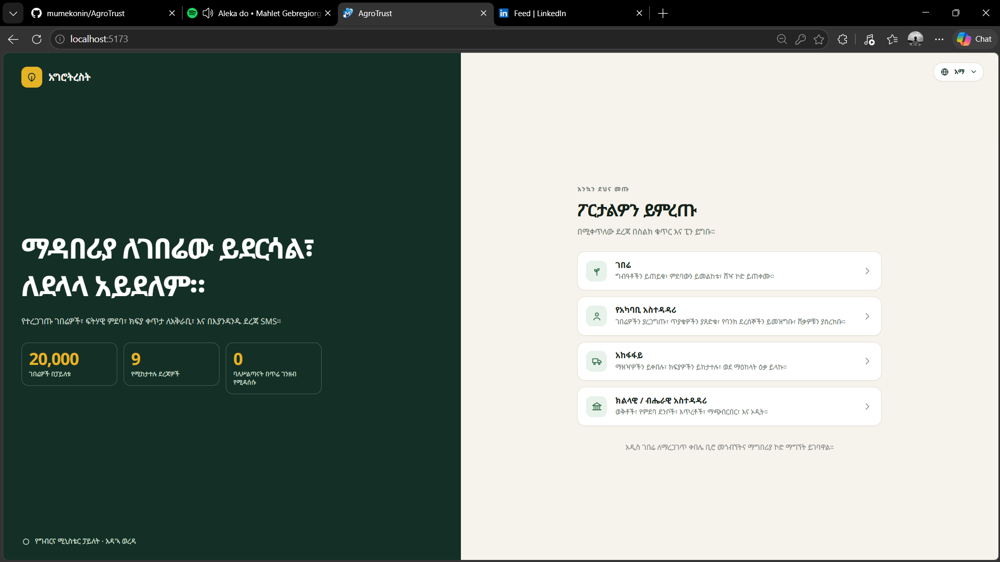
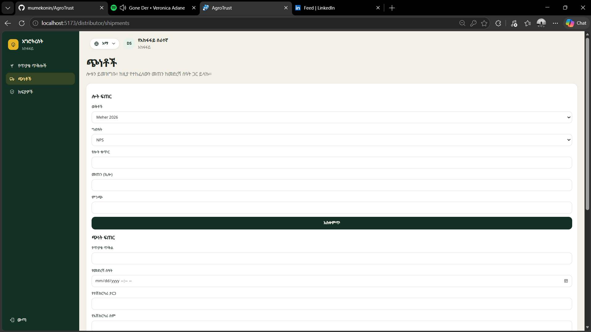
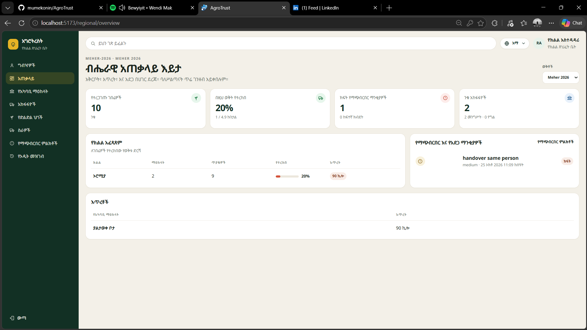
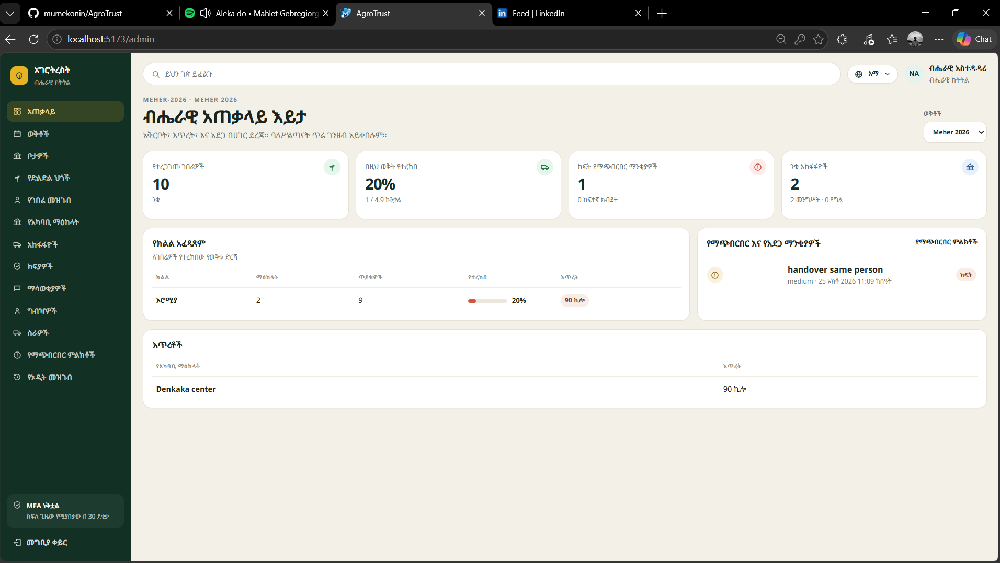

<div align="center">

# 🌾 AgroTrust

[](https://nestjs.com/)
[](https://react.dev/)
[](https://www.mongodb.com/)
[](https://docs.docker.com/compose/)
[](https://jwt.io/)

**AgroTrust records the delivery of fertilizer and other agricultural inputs to smallholder farmers in Ethiopia.**

A local admin verifies each farmer in person. From that point, the entitlement, the request, the bank slip, the shipment, and the handover stay on one record.

</div>

---

## 📌 Problem

Fertilizer often reaches farmers through brokers. Brokers stockpile it and resell it above the official price. There is no shared record of who was entitled to how much, who paid the supplier, or who collected the goods.

That produces three failures:

- 🚫 Farmers with a rightful share are crowded out.
- 💸 The price the farmer pays is not the official price.
- 👁️ Government and suppliers cannot see where a bag went, so shortages and diversion stay invisible.

---

## ✅ Solution

AgroTrust gives each verified farmer a personal entitlement and follows that entitlement until the farmer collects the input.

- A local admin confirms the farmer in person. The farmer then signs in with a phone number and a PIN.
- An allocation rule sets how many kilograms that farmer may receive. A request above the remaining amount is refused.
- The farmer pays the supplier by bank and brings the slip to the kebele. The local admin records the slip. Officials never take the cash.
- The assigned distributor ships only what was paid. The local admin counts what arrived and hands it over against a one-time pickup code.
- Every change is written with an audit record. Distributors see eligibility and quantities, not phone numbers.
- Farmers and staff can use the service in English, Amharic, or Afaan Oromo. SMS tells the farmer when the request is approved, what to pay, when the goods are on the way, and when to collect.

---

## 🔄 How a Delivery Moves

```
Season Setup ──► Farmer Verification ──► Request ──► Approval ──► Payment ──► Shipment ──► Handover
```

1. The national admin registers the season, the official price, the place, the center, and the farmer.
2. The local admin verifies the farmer and issues a one-time activation code.
3. The farmer requests a quantity in kilograms, within the remaining entitlement.
4. The local admin approves the request and sends a requisition to the assigned distributor.
5. The distributor accepts the kilograms, or reduces them with a reason.
6. The farmer pays the supplier. The local admin records the bank-slip number.
7. The distributor ships the paid quantity, with a lot and an arrival time.
8. The local admin counts the delivery and hands the input to the farmer after checking the pickup code.

---

## 👥 Who Uses It

| Role | Responsibility |
|------|----------------|
| 🧑‍🌾 **Farmer** | Requests inputs, pays the supplier, and collects with the pickup code |
| 🏛️ **Local admin** | Verifies farmers, approves requests, records the bank slip, receives stock, and hands goods over |
| 🚚 **Distributor** | Accepts requisitions and ships paid quantities with a lot and an arrival time |
| 🗺️ **Regional admin** | Invites local admins and distributor staff, and watches centers in that region |
| 🏛️ **National admin** | Sets seasons, prices, places, allocation rules, and the farmer registry |
| 🔍 **Auditor** | Reads payments, notifications, fraud flags, and the audit log |

---

## 🖥️ Screens

The pages below follow one delivery, from the public entrance to the national overview.

| Welcome Page | Distributor Portal |
|:---:|:---:|
|  |  |

| Local Admin Dashboard | National Overview |
|:---:|:---:|
|  |  |

---

## 🔒 Security

> Farmers sign in with a phone number and a 6-digit PIN. Staff sign in with a password and an authenticator code. Access tokens are short-lived, refresh tokens rotate, and a sensitive change asks for the password and authenticator again. Staff accounts are created only from an invitation. A new national admin still needs a second national admin to approve the invitation.

---

## 🛠️ Stack

| Part | Choice |
|------|--------|
| **Frontend** | React — English, Amharic, and Afaan Oromo |
| **Backend** | NestJS |
| **Database** | MongoDB replica set, with transactions |
| **Authentication** | JWT (EdDSA), rotating refresh tokens, Argon2id, TOTP |
| **Messages** | SMS gateway. A mock gateway is the default in development |
| **Payment** | Bank slip recorded by the local admin. There is no bank gateway |
| **Local run** | Docker Compose for MongoDB and the API |

---

## 🚀 Run Locally

**Step 1 — Start MongoDB and the API:**

```bash
docker compose up --build
```

**Step 2 — In a second terminal, start the web app:**

```bash
cd frontend
npm install
npm run dev
```

**Step 3 — Open the app:**

Open [http://localhost:5173](http://localhost:5173). The API listens on port **3000**.

---

<div align="center">

**Name:** Mulualem Mekonin &nbsp;|&nbsp; **ID:** CTC-3181-26

</div>
